

<h1 align="center">Mirmire</h1>

<b>A retro game launcher for Android handhelds, phones and TVs that plays your whole library straight from your NAS.</b>

  <a href="https://github.com/Mirmire-Launcher/mirmire/releases/latest"><b>⬇ Download</b></a>
  &nbsp;·&nbsp;
  <a href="docs/GUIDE.md"><b>📖 User guide</b></a>
  &nbsp;·&nbsp;
  <a href="https://mirmire-launcher.github.io/mirmire/theme-maker/"><b>🎨 Theme Studio</b></a>

  
  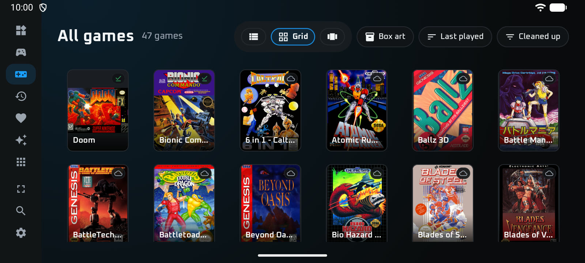
  

Most launchers expect your games on the device and leave the emulators, saves and BIOS files to you. Mirmire is built around a library that lives on your storage, and takes care of the rest.

## Highlights

### 📡 Your NAS is the library

Browse thousands of games over SMB, SFTP, WebDAV or FTP with full artwork, straight from your [RomM](docs/GUIDE.md#romm) server with its covers and saves, or from Google Drive, Dropbox and OneDrive through [rclone](docs/RCLONE.md). Away from home, the same library keeps working through [Tailscale](docs/GUIDE.md#adding-your-games). Nothing is copied ahead of time: a game downloads when you press Play, and big games you haven't played in a while are cleared to free space. Artwork that ES-DE, RetroArch or LaunchBox already downloaded shows up straight away, and favorites, play time and collections come over from [Pegasus and LaunchBox](docs/GUIDE.md#bring-over-from-pegasus-or-launchbox).

### 🔄 Pick up where you left off, on any device

Saves, save states and favorites sync with your storage. Pick up your handheld and the home screen offers to continue the game you were playing on your phone, from the same moment. Press power mid-game and your saves upload before the device sleeps. Devices without shared storage pair over Wi-Fi with a 6-digit code, or sync saves through [Syncthing](docs/GUIDE.md#syncthing). Played the same game on two devices before they synced? Mirmire asks which save to keep, or keeps both, and never overwrites progress.

| Sync & backup | Continue on another device |
|---|---|
|  |  |

### ⚙️ RetroArch and standalone emulators, set up for you

Mirmire downloads cores, sets hotkeys, auto-resume and a sharp picture, and suggests settings for your device. Change any setting for all games, one console or one game without opening RetroArch's menus, and frame the picture with bezels from The Bezel Project.

Original Xbox plays in hakuX, Xbox 360 in Xendroid Plus, PS2 in ARMSX2, PS3 in ARMSX3 or aPS3e, and Steam games from your DroidDeck library in DroidDeck. Emulators that aren't on Google Play install straight from Mirmire, and on Snapdragon devices it finds the latest custom Adreno drivers for the emulators that can load them.

| Settings for every game | Just this console |
|---|---|
|  | 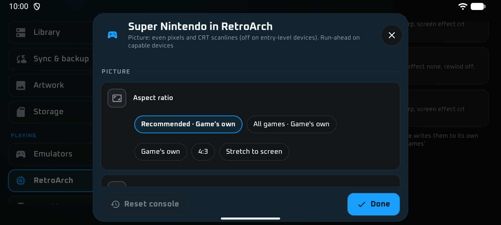 |

### 🧹 A clean, complete library

One version of each game, picked by your preferred regions. Betas and demos are hidden, files are checked against No-Intro so bad dumps stand out, and the BIOS checker tests every file each emulator needs by checksum, says exactly which folder it belongs in, and copies the right files from your storage. A game whose console is missing one tells you before you press Play.

| Library cleanup | BIOS files |
|---|---|
|  |  |

### 🧱 A Home page you build

Clock, weather, calendar, your last game, achievements, play time, music from your storage, widgets from your other apps, and **plugins** shared as a ZIP, like Pixel Pal: a pal that lives on your home page, with hundreds of characters from OpenPets. Drag and resize widgets by touch, or arrange them with a controller.

Turn on AI in **Settings › AI** and Pixel Pal shares tips about the game you just played, chats when you're stuck and can float over the game. Use a free cloud AI (Gemini, Groq or OpenRouter) with your own key, your own server, or a model that runs offline on the device. Only game titles, consoles and what you type are sent.

| Edit the Home page | Pixel Pal |
|---|---|
| 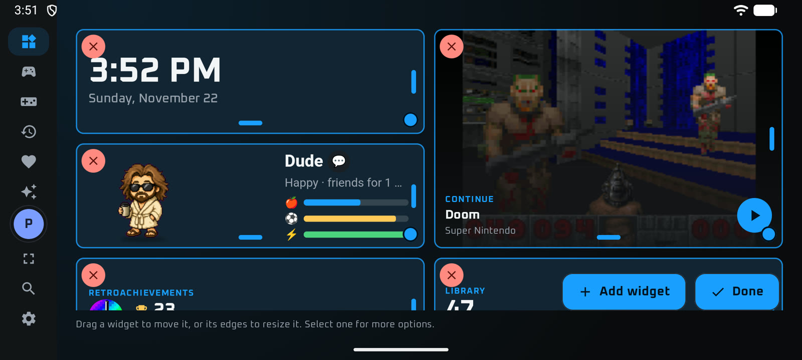 |  |
| **Welcome back** | **Chat while you play** |
|  |  |

### 🖥️ Your PC games, streamed

Games you stream with Moonlight, Artemis or Steam Link sit in their own **Streaming** console, next to everything else. Press Play and the game opens straight in the stream. A streamed game that's also in your Steam library shows once, with a **Stream** button.

### 👨‍👩‍👧 Parental controls

Child profiles see only games up to the age you choose, using ESRB, PEGI and CERO ratings from ScreenScraper, RomM and LaunchBox. Set daily play time, allow or block single games, and keep it all behind a parent PIN. A running game is never cut off.

| Parental controls | Daily play time |
|---|---|
| 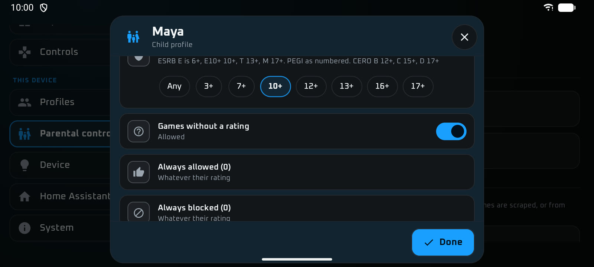 |  |

### 📺 Big Picture and 🪟 dual screen

Big Picture is a full-screen, controller-first home for TVs that switches on by itself when you dock. On the AYN Thor, AYANEO Pocket DS or a Retroid Dual Screen add-on, the second screen shows the selected game's art, description, achievements, manual and map, or your widgets.

| Big Picture | Dual screen |
|---|---|
|  |  |

### 🧊 Big Picture in 3D, with Mirmire Cartouche

Prefer your consoles in 3D? [Mirmire Cartouche](https://github.com/Mirmire-Launcher/mirmire-cartouche), built on [Cartouche](https://github.com/Hakimba/cartouche) by Hakimba, makes Big Picture a 3D home: your consoles as 3D models and your games as their real discs, cartridges and UMDs, with Mirmire's box art as their labels. It's a free, open-source add-on: install it from **Settings › Plugins**, then pick **Settings › Layout › Big Picture style › Cartouche 3D**, or say yes to the 3D Big Picture step in setup. Mirmire still plays every game, so your emulators, saves, achievements and play time stay the same.

| The 3D home | Your consoles in 3D |
|---|---|
|  | 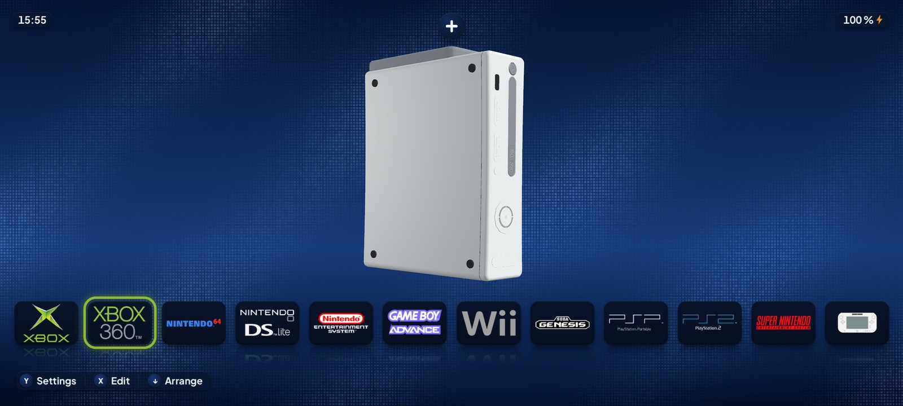 |

### 💡 Stick lights that react

On Retroid and AYN handhelds, the stick lights follow the theme, the battery level, the console, the game's cover art or its performance mode. A one-time setup right on the device turns this on, with no computer or Shizuku needed.

| Light options | A game's color |
|---|---|
|  | 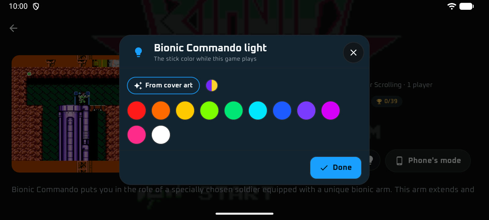 |

### And more

- **👥 Profiles:** each player has their own saves, favorites and play time, with a PIN and a pixel-art avatar if you like.
- **🧩 Plugins:** add widgets from a ZIP and turn each one on or off in **Settings › Plugins**, or make your own in Theme Studio.
- **🏠 Home Assistant:** dim the lights when a game starts on the TV, or run any scene or script when you play, stop or step away.
- **✈️ Pack for a trip:** choose games to take offline. Everything syncs back when you're home.
- **🎮 Play together:** invite a paired device on the same Wi-Fi to a netplay game.
- **🌡️ Learns how hot each game runs:** a battery, standard or performance mode per console, stepping down for games that ran hot.
- **🏆 RetroAchievements:** progress on every game card, the weekly challenge and games close to mastery in Spotlight.
- **🎨 Built for controllers:** every screen works with a gamepad, keyboard or touch, with Xbox, PlayStation or Nintendo button labels.
- **📖 Manuals and maps** from ScreenScraper, your gamelists, ES-DE or LaunchBox.
- **⬆️ Upload local games:** games in your local folder that are missing on the NAS go up with one tap in **Settings › Library**.
- **🎮 Standalone defaults that fit:** Automatic prefers DuckStation for PS1, Mupen64Plus FZ for N64, WatermelonDS for DS and ARMSX2 for PS2 when they're installed.
- **🔊 Volume in Settings › Device**, for handhelds where the buttons are hard to reach.

## Make it yours with Theme Studio

[Theme Studio](https://mirmire-launcher.github.io/mirmire/theme-maker/) builds a theme, an icon pack or a widget plugin in your browser, with a live preview of the app. Nothing you add is uploaded.

- **Colors from one color:** pick one and it builds a full palette, with readability checks.
- **Remix or start fresh:** begin from any of Mirmire's 15 built-in themes, or open any theme or icon pack ZIP.
- **Dual-screen preview:** see your theme on both screens of a dual-screen handheld.
- **Bring your own files:** wallpaper, console icons, backdrops, sounds and music. Files named like other frontends' sets are sorted automatically.

Download the ZIP and import it in **Settings › Look**. See [Make your own themes and icon packs](docs/CREATING.md) and [Make widget plugins](docs/PLUGINS.md).

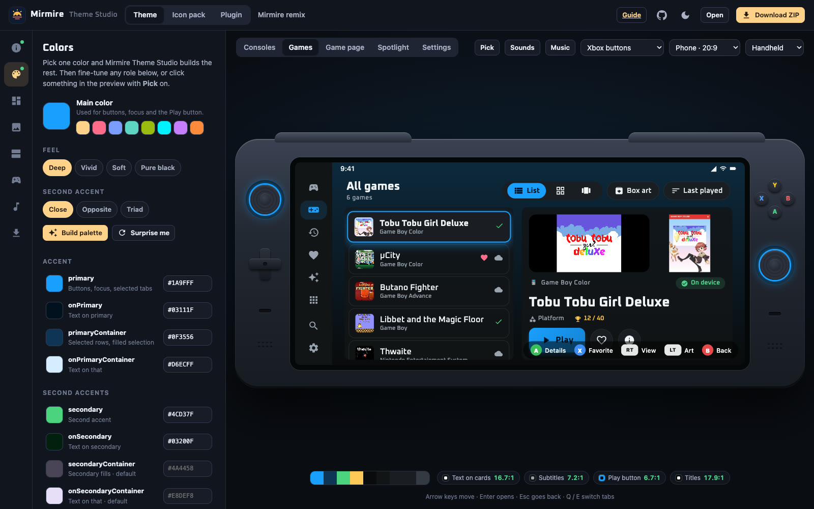

## Download

Get the latest APK from [Releases](https://github.com/Mirmire-Launcher/mirmire/releases/latest). Android may ask you to allow installs from your browser or file manager the first time. After that, Mirmire checks for new versions once a day and installs them from **Settings › System › App updates**.

**Requirements:** Android 8.0 or later, and RetroArch or a standalone emulator for the consoles you want to play. New here? Read the **[User guide](docs/GUIDE.md)**.

## Screenshots

<b>Browse and play</b>

| Consoles | Inside a console |
|---|---|
|  |  |
| **List** | **Cover grid** |
|  |  |
| **Showcase** | **Search** |
|  |  |
| **Game details** | **Description and achievements** |
|  |  |
| **Spotlight** | **Play together** |
|  |  |
| **Android apps** | **Files that didn't pass the check** |
| 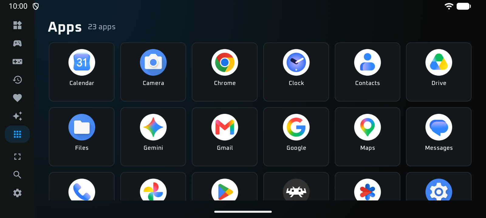 |  |

<b>Home page, Big Picture and dual screen</b>

| Home page | Add a widget |
|---|---|
|  |  |
| **Pixel Pal welcomes you back** | **Chat over a game** |
|  |  |
| **Big Picture** | **Big Picture consoles** |
|  |  |
| **Mirmire Cartouche starting up** | **Games on their discs** |
| 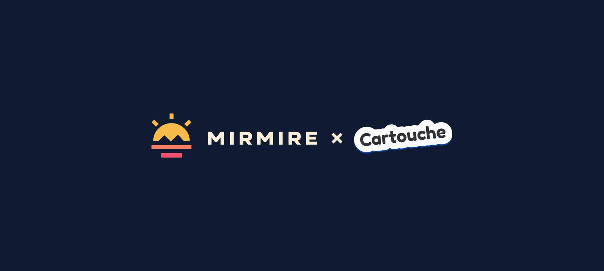 | 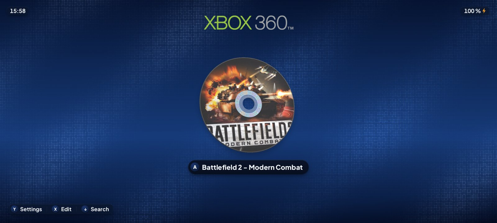 |
| **Big Picture style** | **Mirmire Cartouche in Settings › Plugins** |
| 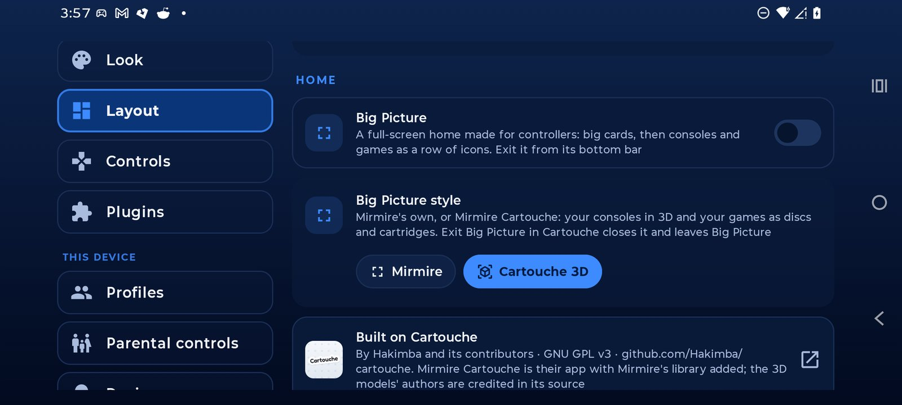 | 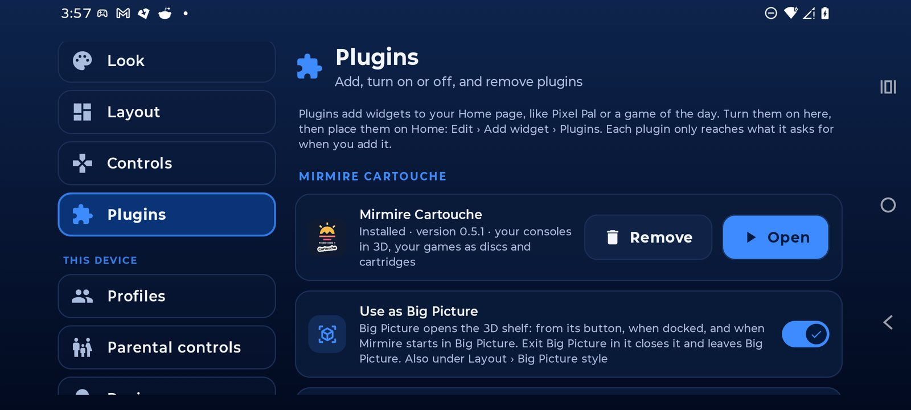 |
| **A console on the second screen** | **Widgets on the second screen** |
|  |  |

<b>Settings</b>

| Library | Sync & backup |
|---|---|
|  |  |
| **Artwork** | **Storage** |
| 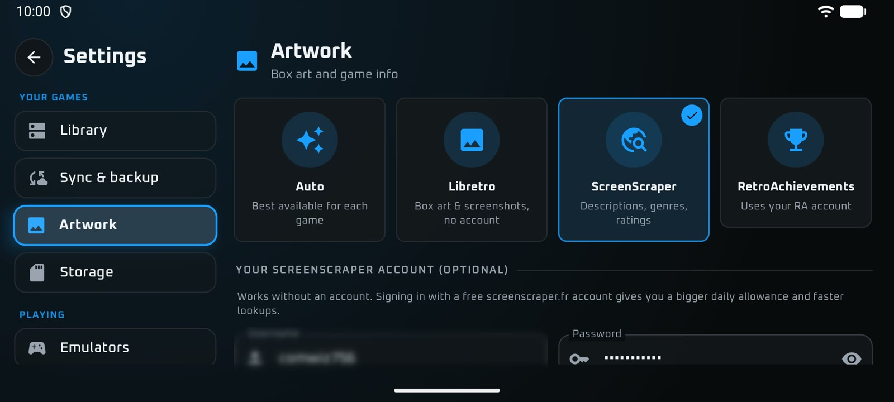 | 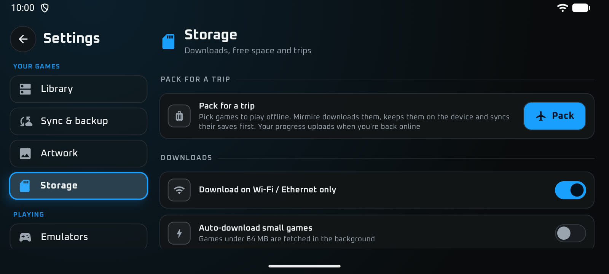 |
| **Emulators** | **RetroArch** |
|  | 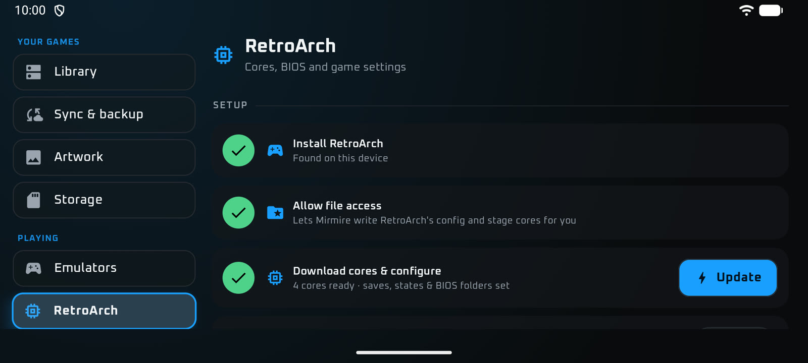 |
| **Trophies** | **AI** |
| 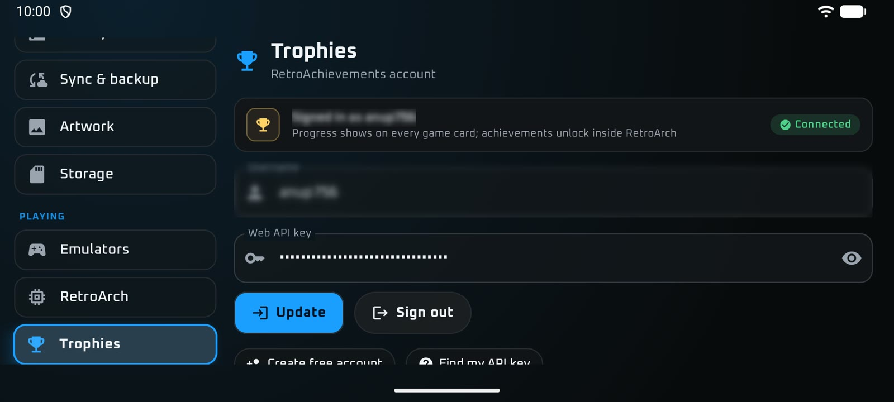 |  |
| **Look** | **Style and console icons** |
|  | 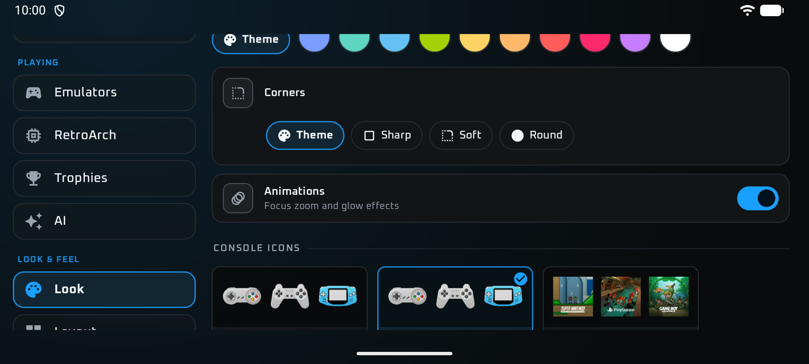 |
| **Layout** | **Controls** |
|  |  |
| **Parental controls** | **Home Assistant** |
|  |  |
| **Device** | **System** |
| 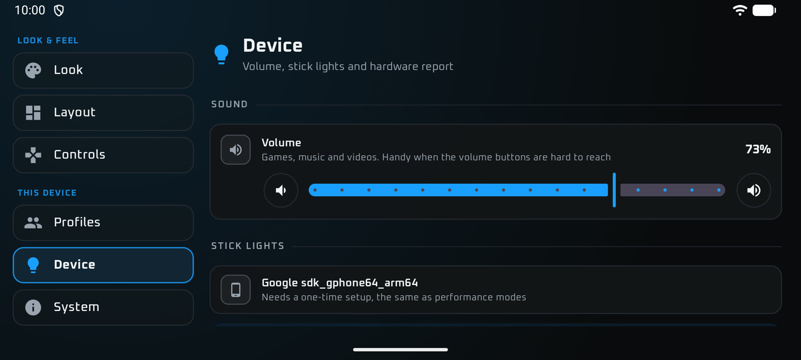 |  |
| **App updates** | **Reset settings** |
|  |  |

<b>RetroArch</b>

| Suggestions for this device | Per game |
|---|---|
|  | 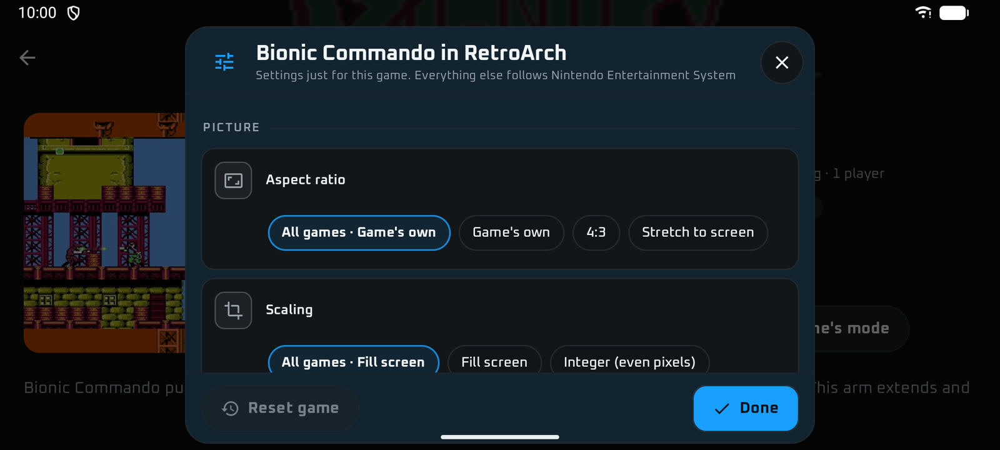 |

<b>Library, sync and profiles</b>

| Preferred regions | Backups |
|---|---|
| 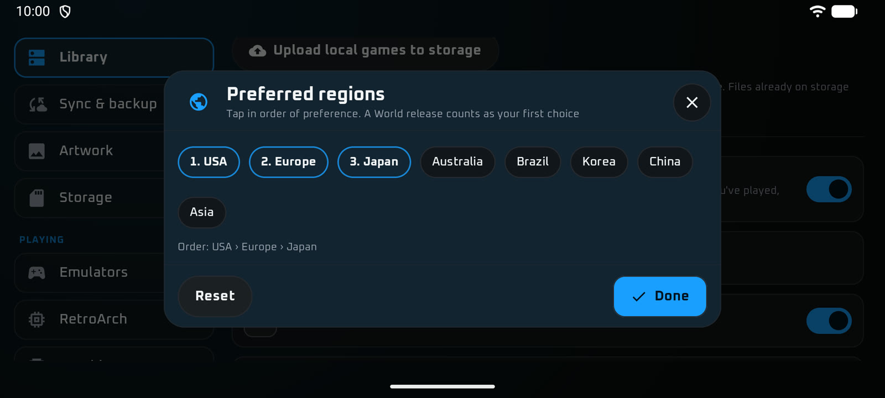 | 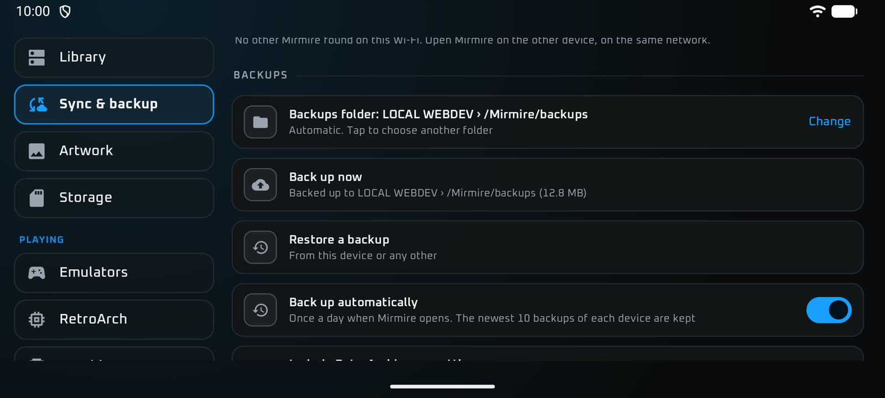 |
| **Pack for a trip** | **Profiles** |
|  |  |
| **Content filter** | **Console light colors** |
|  |  |

<b>Guided setup</b>

| Welcome | Pick a theme |
|---|---|
|  |  |
| **Connect your library** | **You're all set** |
| 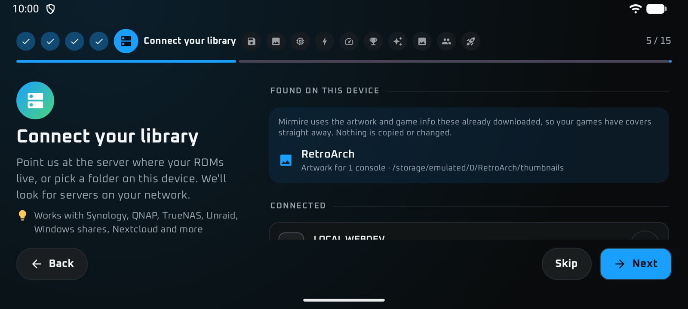 | 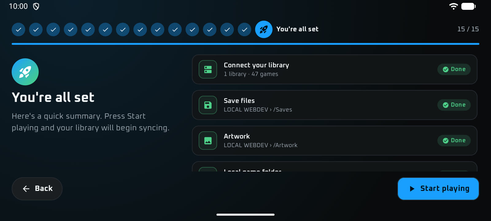 |
| **Who's playing?** | |
|  | |

<b>Portrait</b>

| Consoles | Games | Details | Settings |
|---|---|---|---|
|  | 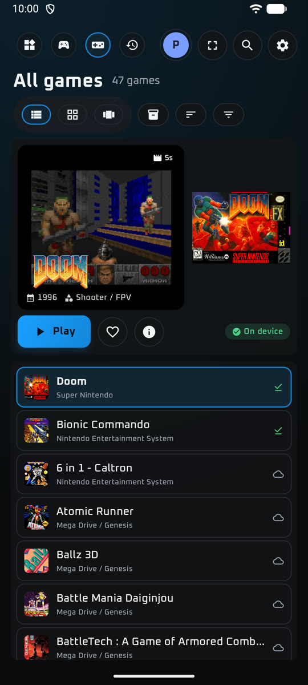 |  | 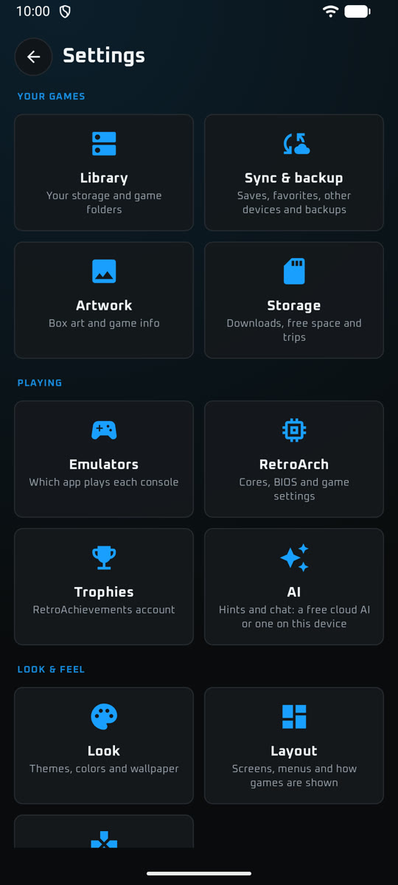 |

---

This repository only hosts releases.

<b>Legal.</b> Mirmire is a launcher only. It doesn't include or provide any games, ROMs or BIOS files: use it with games you own and have the right to play. Games appear in the screenshots for illustration only. DOOM is a registered trademark of id Software LLC, a ZeniMax Media company. Nintendo, Super Nintendo, Game Boy, Nintendo 64, SEGA, Mega Drive, Genesis, PlayStation, Xbox, Steam, RetroArch, and all other game titles, console names and trademarks belong to their respective owners. Game artwork comes from ScreenScraper and the Libretro thumbnail project and belongs to its respective owners. Mirmire is an independent project and isn't affiliated with or endorsed by any of these companies. Profile avatars are made with [DiceBear](https://www.dicebear.com) (MIT): Adventurer and Lorelei by Lisa Wischofsky, Avataaars and Open Peeps by Pablo Stanley, Personas by Draftbit, Miniavs by Webpixels, Toon Head by Johan Melin and Big Ears by The Visual Team (CC BY 4.0, CC0 or the artist's free-use terms), and Critters, Clay, Voxel Art and Voxel Bot by DiceBear (CC0). Moonlight, Steam Link, Syncthing, Home Assistant, Tailscale, Pegasus and LaunchBox names and icons belong to their owners.
