# Mirmire user guide

- [Install](#install)
- [First-time setup](#first-time-setup)
- [Adding your games](#adding-your-games)
- [Browsing and playing](#browsing-and-playing)
- [Home page and widgets](#home-page-and-widgets)
- [Big Picture](#big-picture)
- [Controls](#controls)
- [Emulators and RetroArch](#emulators-and-retroarch)
- [Save sync](#save-sync)
- [Continue on another device](#continue-on-another-device)
- [Library cleanup](#library-cleanup)
- [BIOS files](#bios-files)
- [Artwork](#artwork)
- [RetroAchievements](#retroachievements)
- [Themes and layout](#themes-and-layout)
- [Stick lights](#stick-lights)
- [Spotlight and play time](#spotlight-and-play-time)
- [Profiles](#profiles)
- [Storage](#storage)
- [Pack for a trip](#pack-for-a-trip)
- [Backups](#backups)
- [Home screen widget](#home-screen-widget)
- [Updates](#updates)
- [Troubleshooting](#troubleshooting)

## Install

1. Download the latest `Mirmire-x.y.z.apk` from [Releases](https://github.com/Mirmire-Launcher/mirmire/releases/latest).
2. Open it on your device. Android may ask you to allow installs from your browser or file manager; allow it, then tap **Install**.
3. Optional: to boot straight into Mirmire on a handheld or TV, open **Settings › System › Use as home screen** and choose Mirmire.

## First-time setup

The guided setup walks through everything in about two minutes. Each step can be skipped and changed later in Settings. To run it again, open **Settings › System › Run setup again**.

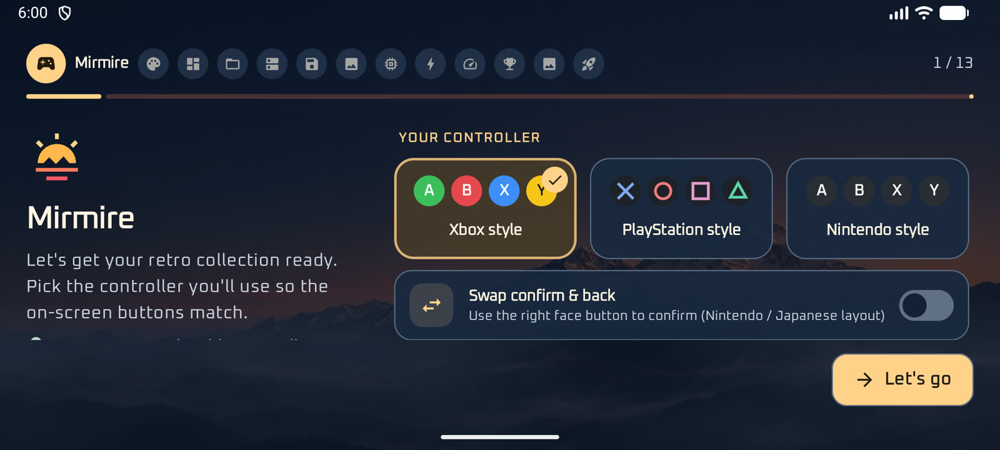

1. **Your controller:** Xbox, PlayStation or Nintendo labels, and whether A/B are swapped.
2. **Make it yours:** a theme and an accent color.
3. **Your layout:** how consoles and games are shown.
4. **Download folder:** where games are saved on this device.
5. **Connect your library:** your network storage or a device folder.
6. **Save files:** where saves sync on your storage.
7. **Artwork:** where box art comes from.
8. **Emulators:** which app plays each console.
9. **RetroArch setup:** cores and recommended settings.
10. **Performance modes** (optional).
11. **Trophies:** your RetroAchievements account (optional).

## Adding your games

Open **Settings › Library › Add library**. Mirmire looks for servers on your network, or you can enter one yourself:

| Type | Use it for | You need |
|---|---|---|
| SMB | Windows shares and most NAS (Synology, QNAP, Unraid…) | Server address, share, username and password |
| SFTP | Linux servers, NAS with SSH | Server address, username, password |
| WebDAV | Nextcloud and other web storage | URL, username, password |
| FTP | Older NAS and routers | Server address, username, password |
| Device folder | Games already on the device or SD card | Pick the folder |

**Folder layout.** Put each console's games in a folder named after the console, for example:

```
ROMs/
  nes/      Super Mario Bros. (USA).nes
  snes/     Super Metroid (USA).sfc
  psx/      Final Fantasy VII (USA).m3u  (+ its .chd discs)
```

ES-DE, RetroArch and Batocera folder names all work (`megadrive`, `genesis`, `md`, `psx`, `ps1`…). Multi-disc games are grouped from `.m3u` playlists or "Disc 1 / Disc 2" names.

After adding a library, press **Sync now**. Mirmire lists your games without downloading them.

## Browsing and playing

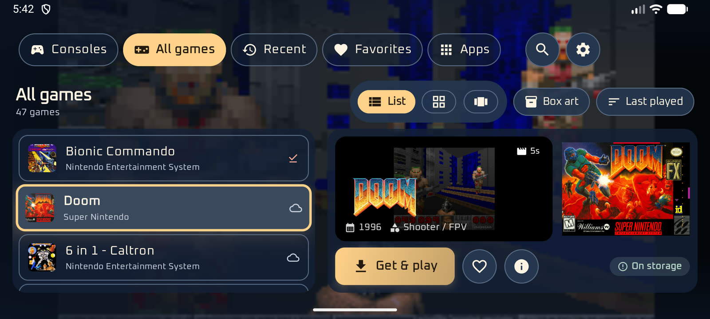

- **Tabs:** Consoles, All games, Recent, Favorites, Spotlight and Apps (your Android apps, handy when Mirmire is the home screen).
- **Views:** list with a preview pane, cover grid, or showcase. Switch with the buttons at the top or **R2**.
- **Artwork type:** box art, 3D box, screenshot, title screen, cartridge, fan art and more. Switch with the artwork button or **L2**.
- **Sort:** by name, last played, recently added or most played. Use the sort button or **Select**.
- **Search:** the magnifier, or **Y**.

Open a game for its details. **Download & play** downloads it to the device, then starts it. Games already on the device just say **Play**. **Offload** removes a game from the device: its saves and states sync to your storage first, and copies that are safely there are removed too. Artwork and play time stay, and downloading it again brings everything back. From the details page you can also:

- favorite (**X**) and pin (**Y**); pinned games are never removed to free space;
- refresh the game's information;
- pick a different emulator for just this game;
- change its RetroArch settings;
- choose a performance mode.


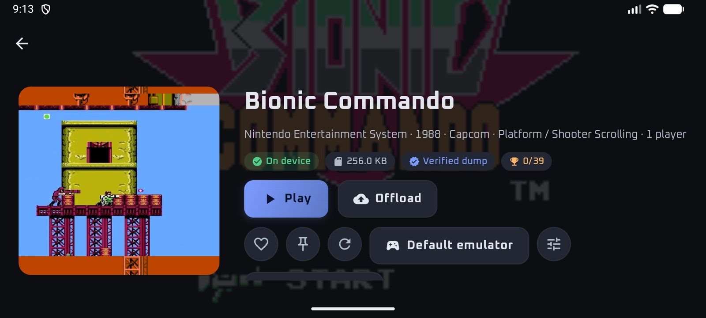
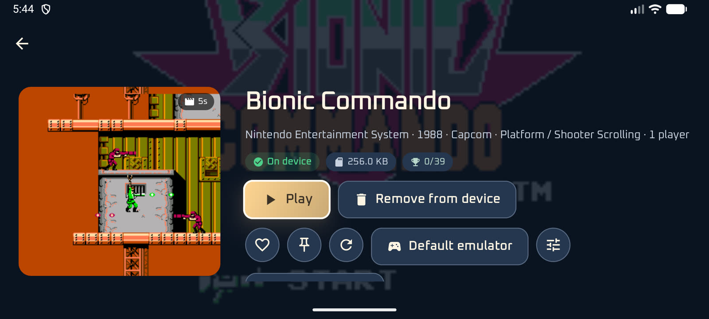

## Home page and widgets

Turn on **Settings › Layout › Home page with widgets** to add a **Home** tab before Consoles. Mirmire opens on it, like a phone's home screen, with widgets you choose.

- **Edit** (or press Select) lets you change the page. **Add widget** opens the list; select a widget to change its size, move it earlier or later, or remove it.
- **With touch,** it works like a phone's home screen: long-press a widget to pick it up and drag it to a new spot. In edit mode, drag a widget's right edge, bottom edge or corner handle to resize it, and press **×** to remove it.
- **Mirmire's widgets:** Clock, Weather (pick a city; forecasts from Open-Meteo), Calendar (your next events, once you allow it), Continue playing, Recently played, Recently added, RetroAchievements, Achievement of the week, Play time and Library.
- **Plugins:** widgets made by players, such as **Pixel Pet**, which comes with Mirmire. Your pet walks around, gets hungry, bored and sleepy, naps at night, cheers when you come back from a game or earn achievements, and wears outfits on a schedule (pajamas at night, Halloween…). Select it to feed it, play ball or give it a pat. In its **Widget options**, name it and choose from hundreds of pets from [OpenPets](https://openpets.dev); the one you pick downloads once and works offline after that. Import more under **Plugins › Import a plugin ZIP**, or in **Settings › Look › Widget plugins**. Before installing, Mirmire shows what the plugin is allowed to do. To make your own, see [Make widget plugins](PLUGINS.md).
- **Apps:** widgets from other apps on the device, as on a phone's home screen. The first time, Android asks you to allow Mirmire to add them.

Sizes are **Small** (1×1), **Wide** (2×1), **Medium** (2×2) and **Large** (4×2). Widgets fill the page in order, four across (two on a narrow screen).

## Big Picture

Big Picture is a full-screen home made for controllers and TVs. Turn it on with the **⛶** button next to Search on the home screen, or in **Settings › Layout › Big Picture**. It stays on, even after a restart, until you exit it.

- **The main menu** is a row of large cards: **Widgets** (your Home page, when it's on), **Continue** (your last game), **Consoles**, **All games**, **Recent**, **Favorites**, **Apps**, **Settings** and **Exit Big Picture**.
- **Consoles, games and apps** open as a row of tiles: just the icon or cover, with its name underneath. The selected one sits in the middle.
- **The Android status and navigation bars are hidden.** Swipe in from the edge to see them for a moment.
- **The bottom bar** shows the Mirmire logo and name, the buttons you can press, your RetroAchievements points (plus unlocks this week and your streak, when you have them), the time and battery, and **Settings** and **Exit** buttons. Press down to reach it.

| Button | Does |
|---|---|
| Left / right | Move along the row |
| A | Open, or play a game (a game that isn't on the device opens its page to download) |
| B | Back |
| X | Favorite the selected game |
| Y | Open the selected game's page |
| L1 / R1 | Jump 10 games at a time |
| Start | Settings |


**Big Picture when docked** (Settings › Layout, on by default): connecting a TV or monitor (HDMI, a USB-C display or a dock) switches to Big Picture in landscape. Unplugging puts your layout back, unless you changed it while docked.

## Controls

| Button | Action |
|---|---|
| D-pad / stick | Move |
| A | Select |
| B | Back (closes the keyboard first) |
| X | Favorite |
| Y | Search (home), keep on device (game details) |
| L1 / R1 | Previous / next tab or settings section |
| L2 / R2 | Artwork type / view |
| Select | Sort |
| Start | Settings |

On a keyboard, arrows move, Enter selects, and Esc or Backspace goes back. On the Consoles screen, **B** returns to the first console. Button labels follow **Settings › Controls**.

## Emulators and RetroArch

**Settings › Emulators** shows which app plays each console. **Automatic** picks the best installed option, or you can choose RetroArch with a specific core, or a standalone emulator.

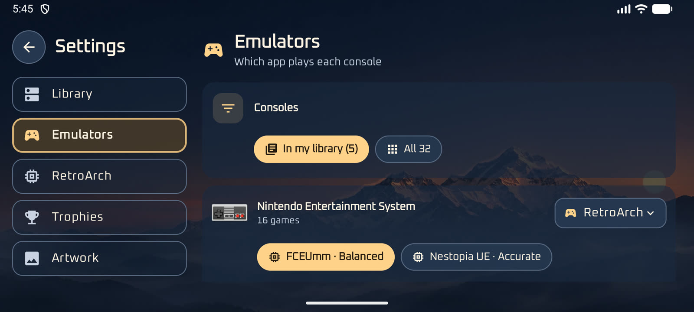

**RetroArch setup** (Settings › RetroArch):

1. Install RetroArch.
2. Allow file access, so Mirmire can write RetroArch's config and prepare cores.
3. Press **Set up** to download the cores your library needs.
4. Once in RetroArch, choose **Load Core › Install or Restore Core** and pick each core.

**RetroArch settings.** Mirmire writes these before each launch, combined from three levels: the game's own settings first, then its console's, then all games'.

- **This device:** shows your device and chip, and suggests settings for it. Nothing changes until you press Apply.
- **All games:** aspect ratio, scaling, smoothing, screen effect (LCD grid or CRT scanlines), run-ahead, fast-forward speed, resume where you left off, rewind, hotkeys, menu combo, input polling, touch controls, graphics driver, threaded video, menu style, pop-ups and FPS.
- **Per console:** Mirmire recommends some settings, such as integer scaling and an LCD grid for handhelds, run-ahead for older 2D consoles, and the N64 and Saturn fixes. You can keep each recommendation, follow all games, or choose your own.
- **Per game:** the settings button on a game's details page.

**Default hotkeys** (hold **Select**, then press):

| Button | Action |
|---|---|
| X | RetroArch menu |
| Start | Quit to Mirmire |
| R1 / L1 | Save / load state |
| R2 | Fast-forward |
| L2 | Rewind (when on) |

Holding **Start** also opens RetroArch's menu.

## Save sync

**Settings › Library › Save files on your storage.** With sync on, your in-game saves upload to `Saves/<console>/` on your storage when you come back to Mirmire, and save states to `Saves/<console>/states/`. Before you play, newer saves and states on the storage are downloaded. Earlier versions of saves are kept, so you can go back to one.

## Continue on another device

When another of your devices played a game more recently, the home screen offers **Continue**: the game opens here with that device's save and save state, so with **Resume where you left off** on you're right where you stopped.

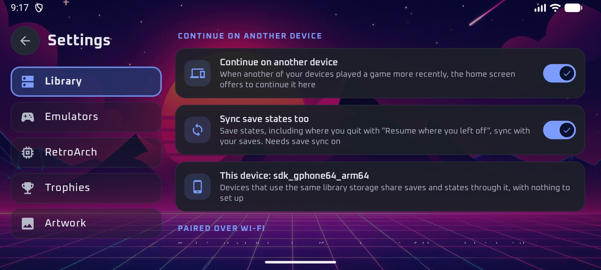

- **Devices that use the same library storage** need no setup: they share saves, states and "last played" through it.
- **Devices without shared storage** (for example, games in a folder on each device) pair once over Wi-Fi in **Settings › Library › Continue on another device**: press **Pair** next to the other device, check that both screens show the same 6-digit code, and accept on the other device. Paired devices swap newer saves and states, encrypted, whenever Mirmire is open on both on the same Wi-Fi. A replaced copy is kept in `Mirmire/retroarch/.peer-backup/`.


**Upload when the screen turns off** (on by default): press power in the middle of a game and its saves and save states upload a few seconds later, and your other devices are told what you were playing so they offer **Continue**. RetroArch writes in-game saves when it pauses. To pick up at the exact moment, save a state first with the hotkey + R1.

**Play together:** with a paired device on the same Wi-Fi, a downloaded game's page shows **Play together**. The other device gets an invite. When it's accepted, the game starts on your device and RetroArch begins hosting by itself. The other device opens the same game with your address filled in; there, open RetroArch's menu (hotkey + X) and choose **Netplay › Connect to Netplay Host**. RetroArch doesn't let other apps make it join a game, so that last step stays manual. Both devices need the same game from the same library.

## Library cleanup

Big libraries often have several versions of each game. **Settings › Library › Cleanup:**

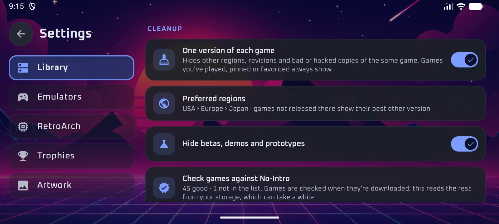

- **One version of each game** shows one copy per game, picked by your **Preferred regions** in order (a World release counts as your first choice), then the latest revision, preferring clean dumps over bad, hacked or translated ones. A game only released elsewhere shows its best version. Games you've played, pinned or favorited always show.
- **Hide betas, demos and prototypes.**
- **Check games against No-Intro:** games are checked against the No-Intro list (from libretro-database) when they're downloaded or already on the device. **Check all** reads the rest from your storage. Disc-based consoles aren't covered. A game's page shows **Verified dump**, **Bad or modified dump** or **Not in No-Intro list**.

The filter button above the games list switches between **Cleaned up**, **Everything** (hidden versions too) and **Didn't pass check**.

| 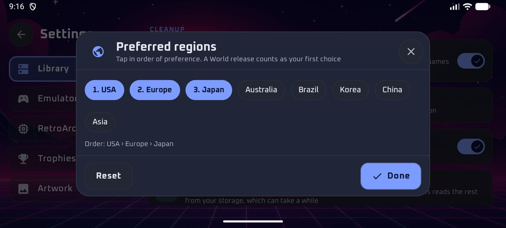 | 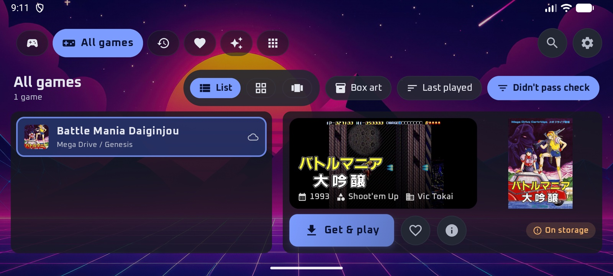 |
|---|---|

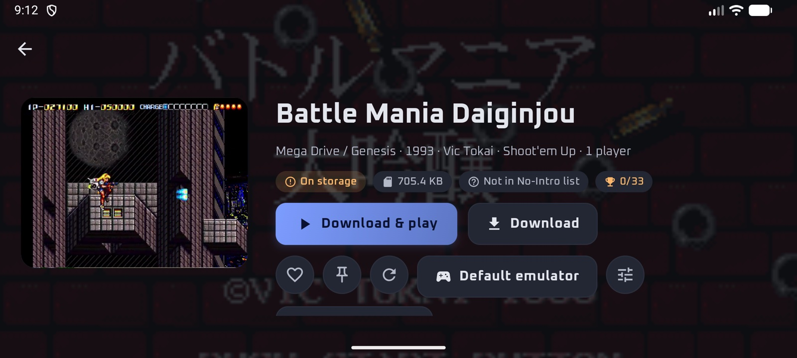

## BIOS files

**Settings › RetroArch › BIOS files** lists the consoles in your library that use BIOS files, with what's found, missing or the wrong version, checked against libretro's BIOS checksums. Tap a console for the file names and where they go.

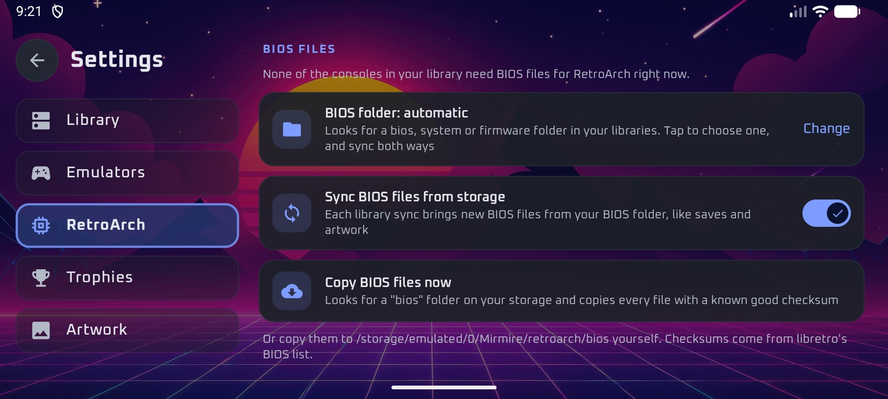

- **BIOS folder:** pick a folder on your storage, like the saves and artwork folders. Files sync both ways: good files there are copied to the device, and good files on the device are uploaded. Left on automatic, Mirmire looks for a `bios`, `system` or `firmware` folder in your libraries.
- **Sync BIOS files from storage** brings new files over on every library sync. Files are recognised by checksum, so `SCPH-5501.BIN` is saved as `scph5501.bin`, where RetroArch expects it.

## Artwork

**Settings › Artwork** picks the source:

| Source | Notes |
|---|---|
| Auto | The best available for each game |
| Libretro | Box art, screenshots and title screens. No account needed |
| ScreenScraper | Adds 3D boxes, cartridges, fan art, videos and descriptions. A free account raises the daily limit |
| RetroAchievements | Uses RetroAchievements images |

Artwork already on your storage, in an ES-DE `downloaded_media` or `media` folder, is used first and kept on the device once loaded. Online lookups only run when you press **Find missing artwork online**.

## RetroAchievements

Sign in under **Settings › Trophies** with your username and **Web API key** (from your RetroAchievements account settings). Progress shows on game cards and pages, and Mirmire also signs RetroArch in for you.

## Themes and layout

- **Look:** theme, accent color, corners, animations, console icons, background (theme wallpaper, gradient, solid color, your own photo or video), and navigation sounds and music. **Get Iconic** and **Get Console Icon Pack** download extra art. You can also import theme or icon-pack ZIPs.
- **Layout:** screen orientation, top bar or side menu, consoles view, console tiles or icons only (with icon size), games view, card size, artwork type, what's shown on cards, and video previews.

Making your own theme, icon pack or widget plugin: try **[Theme Studio](https://mirmire-launcher.github.io/mirmire/theme-maker/)** in your browser, and see [Make your own themes and icon packs](CREATING.md) and [Make widget plugins](PLUGINS.md). The file format is in [THEMES.md](THEMES.md).

## Spotlight and play time

The **Spotlight** tab gathers:

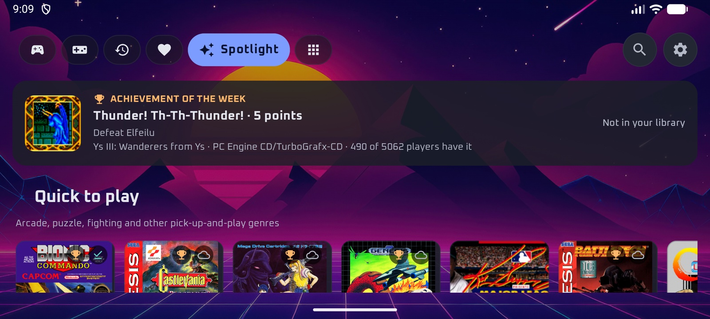

- **Achievement of the week** from RetroAchievements, with a button to the game when it's in your library;
- **Close to mastery:** games nearest to 100% of their achievements;
- **Quick to play:** arcade, puzzle, fighting and other pick-up-and-play genres;
- **Play together:** multiplayer games;
- **Not tried yet:** a new pick every day;
- **Your play time:** this week, all time, your top console and most played games.

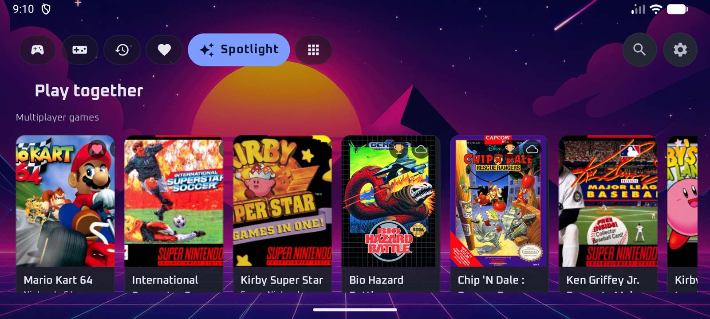

Mirmire times each play from launch until you come back. A game's page shows its play time and, once there's enough history, about how long the battery will last playing it in its performance mode.

**Each game's performance mode is learned** (Settings › Emulators › Performance modes › Learn each game's mode, on by default). After a couple of plays of five minutes or more, a game gets a mode that suits its console: battery saver for 8- and 16-bit systems, standard for consoles like the N64 and PlayStation, and performance for demanding ones like the PS2 and GameCube. If most of its recent plays ended hot (the battery at 41°C or more), it goes one step lower. The game's page says which mode was picked and why. A mode you choose on a game always wins. Modes need Shizuku, as described above.

## Profiles

**Settings › Profiles** (or **Who's playing?** during setup) adds a player for each person. Each has their own favorites, recently played, play time, saves and save states. Switch with the player button next to Search.

| 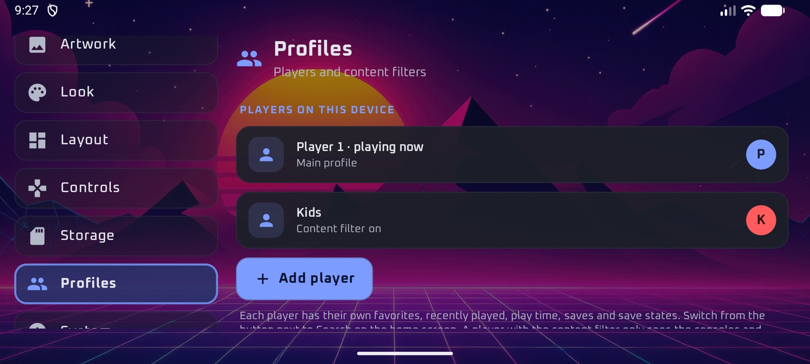 | 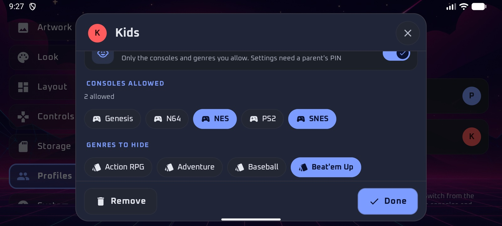 |
|---|---|

- **PIN:** asked when switching to that player.
- **Content filter** (for a child's profile): only the consoles you allow, without the genres you hide. A filtered player can't see hidden games and needs a parent's PIN to open Settings, so set a PIN on your own profile.

RetroAchievements uses one account for every player.

## Stick lights

On Retroid and AYN handhelds with lights around the analog sticks (Retroid Pocket 5, 6 and Mini, AYN Odin 2, Odin 2 Portal, Odin 3 and Thor), Mirmire can set their color. Open **Settings › Device**. This section only appears on those devices, and its light options only once Mirmire has found the lights.

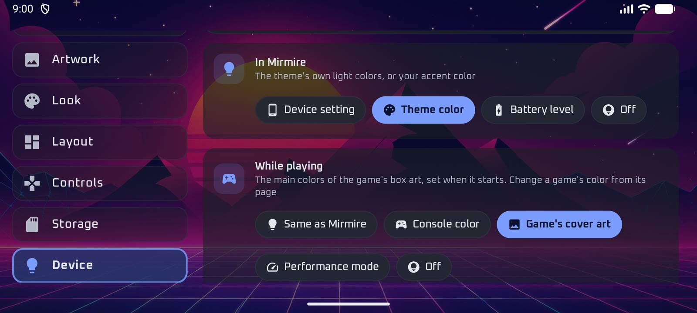

**You need [Shizuku](https://shizuku.rikka.app/)**, the same app performance modes use. Install it, start it, and press **Allow** in Settings › Device. Mirmire then checks which light settings your device has.

**In Mirmire**, the lights can:

- **Device setting:** stay as set in your device's own settings;
- **Theme color:** follow the theme. Some themes have their own pair of light colors (Cyberpunk, Comic, Insert Coin); otherwise the lights use your accent color;
- **Battery level:** go from green when full, through yellow, to red when low;
- **Off:** stay off while Mirmire is open.

**While playing**, a game can start with:

- **Same as Mirmire:** the light doesn't change;
- **Console color:** for example red for NES, blue for Genesis, blue and green for N64;
- **Game's cover art:** the main colors of the game's box art, one per stick;
- **Performance mode:** green for battery saver, the theme's color for standard, red-orange for performance;
- **Off:** the lights turn off when the game starts.

| Console colors | A console's color |
|---|---|
| 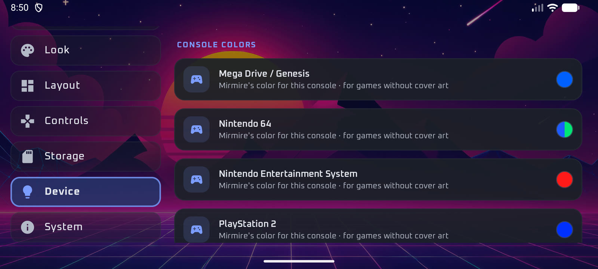 | 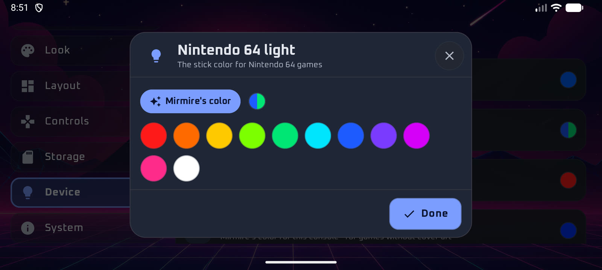 |

With **Console color** or **Game's cover art**, you can change any console's color in the list below. To give one game its own color, press the light button on its details page.

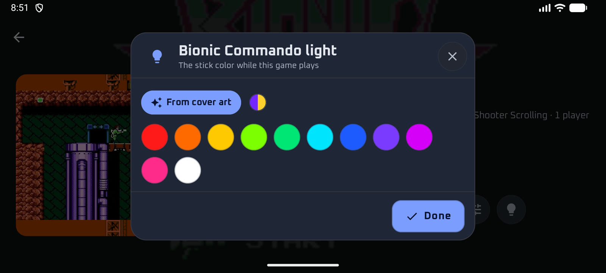

**Brightness** sets how bright the lights are. Mirmire saves your device's own light settings before its first change. **Put back my device's lights**, or setting both options back to the device's own, restores them.

Good to know:

- Lighting effects in your device's settings, such as breathing or rainbow, replace Mirmire's colors. Set the effect to solid there.
- Mirmire sets the color when you switch themes, when the battery level changes and when a game starts. It doesn't run during a game, so the light stays the same until you come back.
- Lights that react to sound aren't supported: they'd need Mirmire running and recording audio during games.

## Storage

**Settings › Storage:**

- download only on Wi-Fi or Ethernet;
- download small games automatically;
- free up space automatically by removing large games you haven't played for a while (saves and pinned games are kept);
- free up space now.

## Pack for a trip

**Settings › Storage › Pack for a trip** gets games ready to play offline. Pick favorites, recently played, games already on the device or whole consoles. Mirmire downloads them, keeps them from being removed to free space, and syncs their saves, states and BIOS files. While you're away, games start without waiting for your storage. When a network is back, saves, settings and "last played" sync straight away. **Back home: unpack** lets free-up-space remove them again.

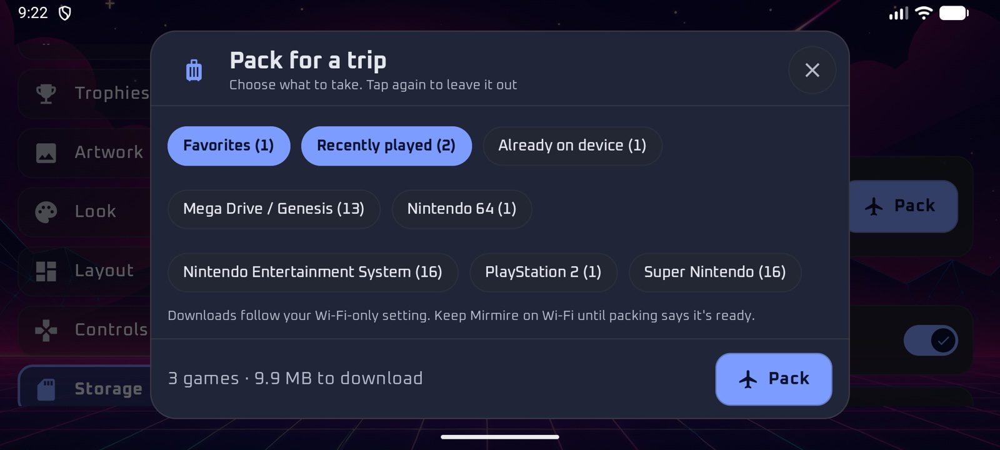

## Backups

**Settings › System › Backups** saves Mirmire's setup to your storage: settings, libraries (without passwords), emulator choices, RetroArch settings, favorites, stick-light colors, imported themes, icon packs and widget plugins, and your Home page widgets (widgets from other apps are left out). Pick the **Backups folder** like the saves folder (automatic: `Mirmire/backups` in your first network library).

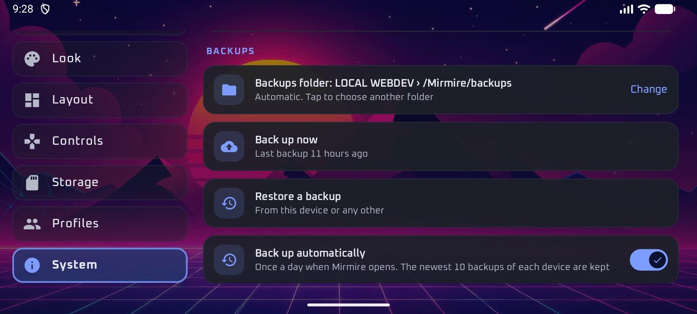

- **Back up automatically:** once a day; the newest 10 backups of each device are kept.
- **Restore a backup:** from this device or any other. Libraries it adds ask for their password.
- **Include RetroArch's own settings** (on by default): also backs up `retroarch.cfg` and the core options, overrides and remaps in RetroArch's config folder. Anything tied to one device is left out: folder paths, video and audio drivers, controller button numbers and screen size. RetroArch's sign-in isn't included either. Restoring merges these into the device's own RetroArch setup. Settings sync doesn't change RetroArch's files; they only come back when you restore a backup.
- **Keep settings in sync:** changes back up a minute later, and Mirmire applies newer settings from your other devices when it opens. Screen orientation, menu style and sizes stay per device.

Passwords and keys are never backed up.

## Home screen widget

This is Mirmire's widget for your phone's own home screen (for widgets inside Mirmire, see [Home page and widgets](#home-page-and-widgets)). On a phone with its own launcher, add the **Mirmire: Continue** widget from your launcher's widget list, or from **Settings › System › Add widget to home screen**. It shows your last game with its play time and the four before it; tap one to open it.

## Updates

**Settings › System › App updates** shows your version and checks this repository for a newer one. When there is one, press **Download**, then **Install**. The first time, Android asks you to allow Mirmire to install apps. Turn on **Check automatically** to check once a day; nothing downloads until you choose to.

## Troubleshooting

**A game says the emulator isn't installed.** Install it from the link in Settings › Emulators, or choose another emulator for that console.

**RetroArch says the core is missing.** Open RetroArch, choose **Load Core › Install or Restore Core**, and pick the core Mirmire named.

**A game shows a black screen in RetroArch.** Switch **Graphics driver** to OpenGL in Settings › RetroArch, or turn off the screen effect for that console.

**N64 controls don't respond.** Keep the recommended **Input polling: Early** for N64.

**Saturn crashes when quitting.** Keep **Resume where you left off** off for Saturn, as recommended.

**My library doesn't find the server.** Enter the address yourself, check the share or folder name, and make sure the device is on the same network.

**An update won't install ("signed with a different key").** That copy of Mirmire came from somewhere else. Uninstall it, then install the release APK. Your library will need to be added again.

**The stick lights don't change.** Check that Shizuku is running and allowed in Settings › Device, and that the lighting effect in your device's settings is set to solid. If Mirmire says no light settings were found, turn the stick lights on once in your device's settings, then press **Check again**.

**A game doesn't start: "BIOS".** Check **Settings › RetroArch › BIOS files** for that console.

**A game is missing from the list.** Library cleanup may show another version instead: switch the filter above the games list to **Everything**.

**Start over.** Settings › System › Reset settings resets each area on its own. Your libraries, downloaded games, saves and artwork are kept.
