# Mirmire user guide

Everything Mirmire does, grouped the same way as its Settings.

**Getting started:** [Install](#install) · [First-time setup](#first-time-setup) · [Adding your games](#adding-your-games) · [rclone (Google Drive, Dropbox, OneDrive)](#rclone-google-drive-dropbox-onedrive) · [RomM](#romm) · [Game streaming](#game-streaming-moonlight-and-steam-link)  
**Playing:** [Browsing and playing](#browsing-and-playing) · [Home page and widgets](#home-page-and-widgets) · [Big Picture](#big-picture) · [Dual screen](#dual-screen) · [Controls](#controls) · [Spotlight and play time](#spotlight-and-play-time) · [RetroAchievements](#retroachievements) · [AI](#ai)  
**Emulators:** [Emulators and RetroArch](#emulators-and-retroarch) · [BIOS files](#bios-files) · [GPU drivers](#gpu-drivers) · [Performance modes and stick lights: one-time setup](#performance-modes-and-stick-lights-one-time-setup)  
**Your library:** [Library cleanup](#library-cleanup) · [Artwork](#artwork) · [Storage](#storage) · [Pack for a trip](#pack-for-a-trip)  
**Sync and backup:** [Save sync](#save-sync) · [Continue on another device](#continue-on-another-device) · [Syncthing](#syncthing) · [Backups](#backups)  
**Make it yours:** [Themes and layout](#themes-and-layout) · [Profiles](#profiles) · [Parental controls](#parental-controls) · [Home Assistant](#home-assistant) · [Stick lights](#stick-lights) · [Home screen widget](#home-screen-widget)  
**Help:** [Updates](#updates) · [Android settings](#android-settings) · [Troubleshooting](#troubleshooting)


## Install

1. Download the latest `Mirmire-x.y.z.apk` from [Releases](https://github.com/Mirmire-Launcher/mirmire/releases/latest).
2. Open it on your device. Android may ask you to allow installs from your browser or file manager; allow it, then tap **Install**.
3. Optional: to boot straight into Mirmire on a handheld or TV, open **Settings › System › Use as home screen** and choose Mirmire.

## First-time setup

The guided setup walks through everything in about two minutes. Each step can be skipped and changed later in Settings. To run it again, open **Settings › System › Run setup again**.

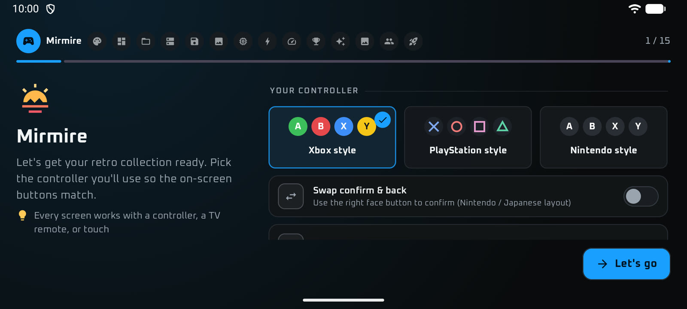

1. **Your controller:** Xbox, PlayStation or Nintendo labels, and whether A/B are swapped.
2. **Make it yours:** a theme and an accent color.
3. **Your layout:** how consoles and games are shown, and whether to start in Big Picture. Turning Big Picture on here only saves the choice: it opens when setup finishes.
4. **Local game folder:** a folder on this device for the games you play. Emulators can't open games straight from a NAS or server, so Mirmire copies a game from your network library here when you play it. Games already on this device stay where they are.
5. **Connect your library:** your network storage or a device folder. If ES-DE, RetroArch or LaunchBox already downloaded artwork on this device, **Found on this device** lists it: Mirmire uses that artwork and game info straight away, without copying or changing it. If ES-DE plays games from a folder here, **Add this ROM folder** adds it in one tap. Saves, states, settings and BIOS files from RetroArch can come too (see [Bring over from RetroArch](#bring-over-from-retroarch)).
6. **Other frontends** (optional): bring over favorites, play time, collections and artwork from Pegasus or LaunchBox (see [Bring over from Pegasus or LaunchBox](#bring-over-from-pegasus-or-launchbox)).
7. **Save files:** where saves sync on your storage, or [Syncthing](#syncthing) to sync them straight between your devices.
8. **Artwork:** where box art comes from.
9. **Emulators:** which app plays each console.
10. **Stream from your PC** (only when Moonlight, Artemis or Steam Link is installed): turn on **Add Moonlight games** or **Add Steam Link** to set up the ones you use (see [Game streaming](#game-streaming-moonlight-and-steam-link)).
11. **RetroArch setup:** cores and recommended settings. **Check BIOS files** opens the [BIOS page](#bios-files); Back returns to setup.
12. **Performance modes** (optional): a one-time setup, also used for stick lights on Retroid and AYN handhelds.
13. **Trophies:** your RetroAchievements account (optional).
14. **AI helper** (optional): Pixel Pal's hints and chat (see [AI](#ai)).
15. **Home Assistant** (optional): turn on **I use Home Assistant** to connect it (see [Home Assistant](#home-assistant)).
16. **Plugins** (optional): turn plugins on or off, or add one from a ZIP (see [Plugins](#plugins)).
17. **3D Big Picture** (optional): install Mirmire Cartouche, open or remove it, and turn on **Use as Big Picture** to make it your Big Picture (see [Big Picture in 3D](#big-picture-in-3d-mirmire-cartouche)). Skip it and Big Picture stays Mirmire's own.
18. **Artwork & info:** where box art and descriptions come from.
19. **Who's playing?** Your name, color, avatar and an optional PIN; **Set up parental controls** for a parent PIN and children's profiles; and anyone else who plays.

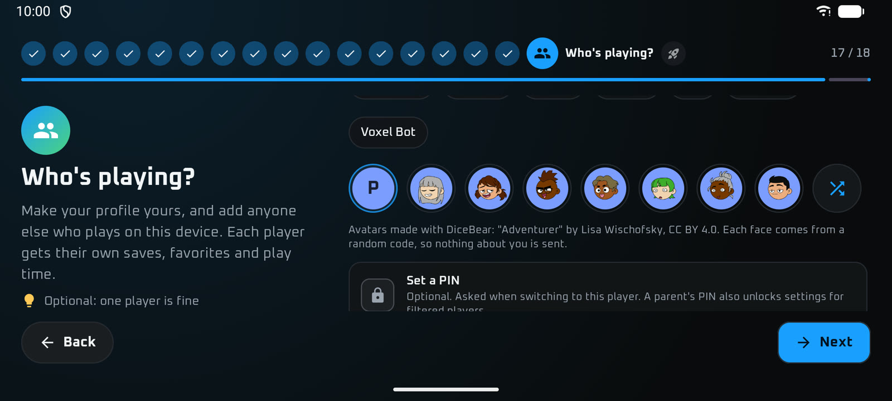

## Adding your games

Open **Settings › Library › Add library**. Mirmire looks for servers on your network, or you can enter one yourself:

| Type | Use it for | You need |
|---|---|---|
| SMB | Windows shares and most NAS (Synology, QNAP, Unraid…) | Server address, username and password |
| SFTP | Linux servers, NAS with SSH | Server address, username, password |
| WebDAV | Nextcloud and other web storage | Server address, username, password |
| rclone | Google Drive, Dropbox, OneDrive and other rclone remotes | A PC/NAS running `rclone serve webdav` (see [rclone](#rclone-google-drive-dropbox-onedrive)) |
| FTP | Older NAS and routers | Server address, username, password |
| RomM | A [RomM](https://romm.app) server you already run | RomM's web address, then pair the device in RomM, or sign in with your RomM username and password (see [RomM](#romm)) |
| Device folder | Games already on the device or SD card | Pick the folder |

**Sign in, then pick the folder.** For network storage, enter the address and your username and password, then choose **Connect & browse**. Mirmire signs in and shows the folders on the server (for SMB, first the shares on your NAS, so you don't need to know the share name): open a folder to look inside, choose **Up one level** to go back, and choose **Use this folder** on the folder that holds your console folders. Console folders it recognises are marked, so you can see when you've found the right place. You can still type the path yourself under **Or type the path (optional)**. **Test** checks the folder and lists the consoles it found.

If signing in fails, Mirmire says why: wrong username or password, server not found, couldn't reach the server, connection timed out, folder or share not found, or permission denied.

**Away from home with Tailscale.** If you use [Tailscale](https://tailscale.com), fill in **Away from home (optional)** with the NAS's Tailscale name or 100.x address, for example `nas.tail1234.ts.net`. Mirmire tries the home address first and switches to the Tailscale one when the home address doesn't answer, so the same library works on your Wi-Fi and on the road. After **Test**, the editor shows which address is in use, and each library in the list is marked **Home** or **Tailscale**. It works for SMB, SFTP, WebDAV, rclone, FTP and RomM libraries. Mirmire doesn't include Tailscale: install the Tailscale app and sign in, and Mirmire shows whether it's connected.

**Folder layout.** Put each console's games in a folder named after the console, for example:

```
ROMs/
  nes/      Super Mario Bros. (USA).nes
  snes/     Super Metroid (USA).sfc
  psx/      Final Fantasy VII (USA).m3u  (+ its .chd discs)
```

ES-DE, RetroArch and Batocera folder names all work (`megadrive`, `genesis`, `md`, `psx`, `ps1`…). Multi-disc games are grouped from `.m3u` playlists or "Disc 1 / Disc 2" names.

**Xbox and Xbox 360** go in `xbox/` (`.iso`, `.xiso`, `.cso`, `.cci`) and `xbox360/` or `x360/` (`.iso`, `.zar`, or an extracted game folder with its `default.xex`).

**Steam games** from DroidDeck: add a Steam library folder (the one that holds `steamapps`, for example `SteamLibrary` on your SD card) as a game library. Each installed game shows with its Steam name and art. DroidDeck's built-in library lives in its private storage, which other apps can't read, so only libraries on an SD card or shared storage appear.

**PlayStation 3** games go in `ps3/` as `.iso` disc images. Extracted game folders and games installed from `.pkg` files are started from inside the PS3 emulator. PS2 also takes `.gz`, `.mdf`, `.nrg` and `.img` images, alongside `.iso`, `.chd`, `.cso`, `.zso` and `.cue`.

After adding a library, press **Sync now**. Mirmire lists your games without downloading them.

---


**Upload local games to storage.** If you already have games in your **local game folder** that aren't on the network library (or are incomplete there), open **Settings › Library › Upload local games to storage**. Mirmire uploads only what's missing; files already on the NAS at full size are left alone. Uses the same Wi‑Fi / Ethernet-only setting as downloads.

### Bring over from Pegasus or LaunchBox

**Settings › Library › Bring over from other frontends** finds Pegasus and LaunchBox folders on the device, or you can pick one. Before anything changes, it shows what it found: matched games, new favorites, play time and plays to add, pictures, collections, and the games it couldn't match. Then press **Import**.

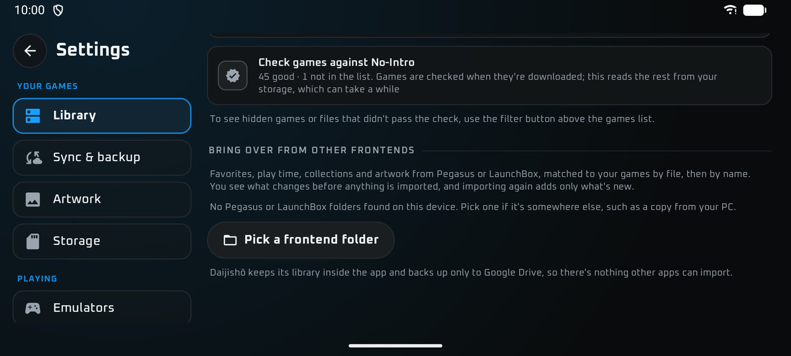

- **Pegasus:** `metadata.pegasus.txt` collections and games, `media/` pictures, favorites and play time.
- **LaunchBox:** platform files, playlists (as collections), and the Images, Videos and Manuals folders.
- Games are matched by path, then file name, then title within the console. Play time is only ever added, and importing again adds only what's new.
- Pictures fill in games that have none of that kind. Turn on **Use their artwork everywhere** to replace Mirmire's own.
- Imported collections open as game lists.

Daijishō keeps its data private to the app, so it can't be imported. ES-DE gamelists are read automatically when you add a library.

## rclone (Google Drive, Dropbox, OneDrive)

Mirmire does not sign in to Google or Dropbox itself. On a PC or NAS, run [rclone](https://rclone.org/) and serve your ROM folder over WebDAV, then add an **rclone** library in Mirmire.

```bash
rclone serve webdav gdrive:roms --addr :8080 --user mirmire --pass secret
```

In Mirmire: choose **rclone**, enter the machine's LAN IP, port **8080**, and the same user/pass. Keep that serve command running while you browse or play. Full steps: **[rclone guide](RCLONE.md)**.

## RomM

If you run [RomM](https://romm.app), Mirmire can use it as a library directly. Your games, covers and details come from RomM, so you don't need ScreenScraper for them.

1. Open **Settings › Library › Add library** and choose **RomM**.
2. Enter the address you open RomM at in a browser, for example `192.168.1.20` or `https://romm.example.com`. Add the port if it isn't 80 or 443, and turn on **Use HTTPS** if RomM is served over HTTPS. Pasting the full address with `https://` works too, and so does a sub-path such as `nas.local/romm`.
3. Sign in. The easiest way is **Pair with RomM**: Mirmire shows a code and an address (`<your RomM address>/pair/device`). Open that address on your phone or computer, in a browser that's signed in to RomM, enter the code and choose **Approve**. Mirmire signs in by itself within a few seconds, and no password is typed or stored on the device. RomM then lists the device under your devices, where you can remove it later. The code lasts 10 minutes.
   - **On a phone, scan RomM's QR code:** in RomM, open **Profile › Client API tokens**, create a token (read access to ROMs, platforms and assets, plus write access to assets for save sync) and choose **Pair**. RomM shows a QR code. In Mirmire, choose **Scan RomM's QR code** and point the camera at it. Mirmire fills in the server's address and signs in by itself, so you can skip step 2. Allow camera access the first time. This button only shows on devices with a camera.
   - **Or use a pairing code from RomM:** in RomM, open **Profile › Client API tokens**, create a token and choose **Pair** as above. Type the code it shows into **Or a pairing code from RomM** and choose **Use code**. These codes last a minute.
   - **Or sign in** with your RomM username and password, or leave the username empty and paste an API token into the password field.
4. Mirmire checks the connection, shows the RomM version and lists RomM's platforms, with a switch for each. Turn off any platform you don't want here. Platforms Mirmire can't play, such as arcade or PC, are greyed out. If you signed in with a password, press **Test** to see them.
5. Press **Save & scan**.

If the test fails, Mirmire says why: RomM didn't accept the sign-in, the pairing was declined or ran out, the server is too old to offer pairing, the address answers but isn't a RomM server, the server can't be reached, or the account isn't allowed to read the library.

**How it works.** Each RomM platform maps to the matching Mirmire console, and every ROM becomes a game with RomM's name, cover, summary, genre and release date. Games download from RomM when you press Play, the same way they do from a NAS. Multi-file games, such as a CUE sheet with its tracks, download together in their own folder. Large libraries are fetched in pages, so they list quickly. Mirmire lists every version RomM has, then **Library cleanup** shows one per game in your preferred regions. Games you hid in RomM stay hidden. A cover or summary you change in RomM shows here after the next **Sync now**.

**Saves.** With [Save sync](#save-sync) on, saves and save states for RomM games are stored as RomM saves and states on the game's page in RomM. That means RomM's web player and other RomM apps see them too. Saves made with a core-specific folder, or by another Mirmire profile, are labelled with the core or profile name in RomM's emulator field. Mirmire's own bookkeeping, such as earlier versions of a save and the note of which device saved last, stays on the device. If you set a central saves folder on another library, RomM games' saves go there instead.

**Not yet covered:** RomM collections and firmware (BIOS) files, and uploading games to RomM. Add games in RomM itself and run a scan there, then press **Sync now** in Mirmire.

## Game streaming (Moonlight and Steam Link)

Games you stream from your PC can sit in Mirmire next to everything else, under a **Streaming** console. You need [Moonlight](https://moonlight-stream.org) (or Artemis) with Sunshine on the PC, or Steam Link.

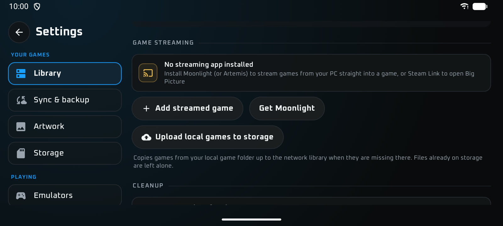

1. Open **Settings › Library › Game streaming** and choose **Add a streamed game**.
2. Enter the **PC name** as Moonlight lists it and the game's name, like `Desktop` or `Hades`. Add the **PC address** and press **Look up** to check the PC answers, or **Paste a Moonlight shortcut** instead.
3. For Steam Link, choose **Add Steam Link**. It opens Steam Link, where you pick the game.

When Mirmire is your home app, Moonlight's **Create shortcut** on a PC or a game adds it to Mirmire too.

Press Play and the game opens straight in Moonlight. If a streamed game is also in your Steam library, it shows once, as the Steam game, with a **Stream** button. Moonlight doesn't let other apps read its list of PCs and games, so each one is added once by hand or by shortcut.

## Browsing and playing


- **Tabs:** Consoles, All games, Recent, Favorites, Spotlight and Apps (your Android apps, handy when Mirmire is the home screen).
- **Views:** list with a preview pane, cover grid, or showcase. Switch with the buttons at the top or **R2**.
- **Artwork type:** box art, 3D box, screenshot, title screen, cartridge, fan art and more. Switch with the artwork button or **L2**.
- **Sort:** by name, last played, recently added or most played. Use the sort button or **Select**.
- **Search:** the magnifier, or **Y**.

Open a game for its details. **Download & play** downloads it to the device, then starts it. Games already on the device just say **Play**. **Offload** removes a game from the device: its saves and states sync to your storage first, and copies that are safely there are removed too. Artwork and play time stay, and downloading it again brings everything back. From the details page you can also:

- favorite (**X**) and pin (**Y**); pinned games are never removed to free space;
- refresh the game's information;
- pick a different emulator for just this game;
- change its RetroArch settings;
- choose a performance mode;
- read the game's **manual** or look at its **map**, when it has one (see below).

**Manuals and maps.** A book or map button appears on a game's page when one is found. Manuals open page by page, maps as one big image; zoom with the buttons or by pinching, and **Close** when done. They come from ScreenScraper, your `gamelist.xml` (`<manual>` and `<map>`), your artwork folder (`<console>/media/manuals/` and `media/maps/`), or ES-DE and LaunchBox on the device. A manual is kept on the device after the first time you open it. On a dual-screen handheld they open on the second screen too, so you can read while you play.


## Home page and widgets

Turn on **Settings › Layout › Home page with widgets** to add a **Home** tab before Consoles. Mirmire opens on it, like a phone's home screen, with widgets you choose.

- **Edit** (or press Select) lets you change the page. **Add widget** opens the list; select a widget to change its size, move it earlier or later, or remove it.
- **With touch,** it works like a phone's home screen: long-press a widget to pick it up and drag it to a new spot. In edit mode, drag a widget's right edge, bottom edge or corner handle to resize it, and press **×** to remove it.
- **Mirmire's widgets:** Clock, Weather (pick a city and °C or °F; forecasts from Open-Meteo), Calendar (your next events, once you allow it), Continue playing, Recently played, Recently added, RetroAchievements, Achievement of the week, Play time, Library and Music.
- **Music** plays MP3, M4A, FLAC, OGG or WAV files from a folder on your storage (and the folders inside it) while Mirmire is open, shuffled or in order. Choose the folder in its options. It pauses when a game starts or the screen turns off, and the theme's own music waits while it plays. Press the widget to play or pause.
- **Plugins:** widgets made by players, such as **Pixel Pal**, which comes with Mirmire. Your pal walks around, gets hungry, bored and sleepy, naps at night, cheers when you come back from a game or earn achievements, and wears outfits on a schedule (pajamas at night, Halloween…). Select it to feed it, play ball or give it a pat. In its **Widget options**, name it (left blank, it goes by its OpenPets character's own name) and choose from hundreds of pals from [OpenPets](https://openpets.dev); the list and the pal you pick are kept, so both work offline after the first time. Under **AI hints** you can let your pal share a short tip or fun fact about the game you just played, and now and then a word about your collection. It's off until you turn it on, and it uses the AI you set up in **Settings › AI** (see [AI](#ai)). AI lines carry an **AI** tag, and the AI goes by the name you gave your pal (or Mirmire if you didn't name it). With AI on, the 💬 button next to your pal's name opens a chat: ask for tips, help getting past a level, trivia or what to play next; it knows the game you played last. Your pal keeps one conversation on the Home page and a separate one for each game while you play it, each with its last 20 messages, so a chat stays short and about the right game. **Clear chat** starts over. On a handheld with a second screen, keep your pal there while you play: it gives a tip when the game starts and checks in every few minutes. With RetroAchievements connected (and signed in inside RetroArch), its tips can be about where you are in the game, such as the level you're on. If the AI can't be reached, your pal just uses its usual lines. Import more under **Plugins › Import a plugin ZIP**, or in **Settings › Plugins**. Before installing, Mirmire shows what the plugin is allowed to do. To make your own, see [Make widget plugins](PLUGINS.md).

### Plugins

**Settings › Plugins** lists every plugin, with a switch to turn each one on or off. A plugin that's off stays installed but isn't offered or run; its widget on Home says it's turned off until you turn it back on. **Add a plugin** installs one from a ZIP, after showing what it may reach. **Remove** deletes a plugin you added, and its widgets with it; plugins that come with Mirmire, such as Pixel Pal, can only be turned off. **Theme Studio** opens the browser tool for making your own. The same page is a step in setup.

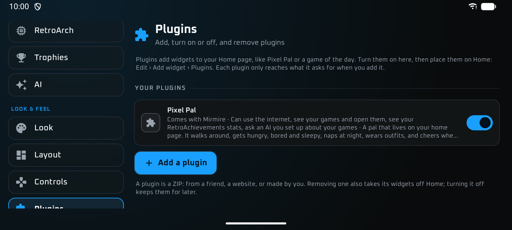
- **Apps:** widgets from other apps on the device, as on a phone's home screen. The first time, Android asks you to allow Mirmire to add them.

Sizes are **Small** (1×1), **Wide** (2×1), **Medium** (2×2) and **Large** (4×2). Widgets fill the page in order, four across (two on a narrow screen). On a small widget, text shrinks a little to fit rather than being cut off.

With a second screen in use, the Home tab leaves the main screen; choose **Home page widgets** for the second screen to keep them (see [Dual screen](#dual-screen)).

| The Home page | Pixel Pal's options |
|---|---|
|  | 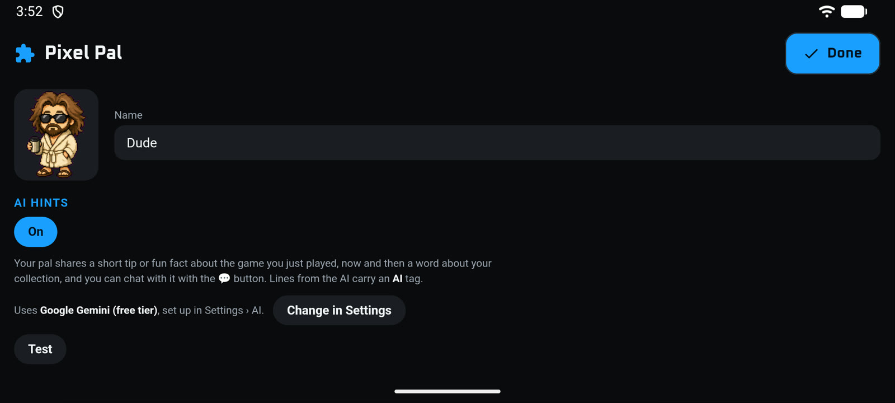 |

## Big Picture

Big Picture is a full-screen home made for controllers and TVs. Turn it on with the **⛶** button next to Search on the home screen, or in **Settings › Layout › Big Picture**. The switch in Settings only saves the choice: Big Picture opens once you're back on the home. **Big Picture style** picks Mirmire's own (below) or [Big Picture in 3D](#big-picture-in-3d-mirmire-cartouche). It stays on, even after a restart, until you exit it.

- **The main menu** is a row of large cards: **Widgets** (your Home page, when it's on), **Continue** (your last game), **Consoles**, **All games**, **Recent**, **Favorites**, **Apps**, **Settings** and **Exit Big Picture**.
- **Consoles, games and apps** open as a row of tiles: just the icon or cover, with its name underneath. The selected one sits in the middle.
- **The Android status and navigation bars are hidden,** dialogs included, and again when you come back from a game. Swipe in from the edge to see them for a moment. Retroid handhelds keep their three-button bar on screen whatever an app asks; there Mirmire hides the status bar and keeps everything above the buttons. To hide them too, switch the Retroid to gesture navigation in its own settings.
- **The bottom bar** shows the Mirmire logo and name, the buttons you can press, your RetroAchievements points (plus unlocks this week and your streak, when you have them), the time and battery, and **Settings** and **Exit** buttons. Press down to reach it.

| Button | Does |
|---|---|
| Left / right | Move along the row |
| A | Open, or play a game (a game that isn't on the device opens its page to download) |
| B | Back |
| X | Favorite the selected game |
| Y | Open the selected game's page |
| L1 / R1 | Jump 10 games at a time |
| Start | Settings |


**Big Picture when docked** (Settings › Layout, on by default): connecting a TV or monitor (HDMI, a USB-C display or a dock) switches to Big Picture in landscape. Unplugging puts your layout back, unless you changed it while docked.

| The main menu | Consoles |
|---|---|
| 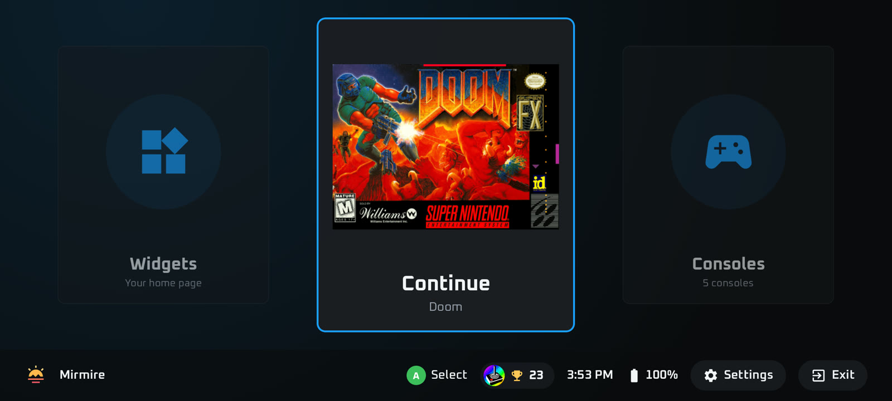 |  |

### Big Picture in 3D (Mirmire Cartouche)

[Mirmire Cartouche](https://github.com/Mirmire-Launcher/mirmire-cartouche) is a separate, free and open-source app built on [Cartouche](https://github.com/Hakimba/cartouche) by Hakimba. It turns Big Picture into a 3D home: your consoles as 3D models, your games as their discs, cartridges and UMDs with Mirmire's box art as their labels.

- **Install it** from **Settings › Plugins › Mirmire Cartouche › Install**, or the **3D Big Picture** step in setup (about 225 MB; Android asks once whether Mirmire may install apps). Updates come from the same button, and **Remove** uninstalls it.
- **Use it as Big Picture:** **Settings › Layout › Big Picture style › Cartouche 3D**, the **Use as Big Picture** switch in Settings › Plugins, or the same switch in setup's **3D Big Picture** step. **Big Picture style** shows once Mirmire Cartouche is installed. Turning it on in setup or Settings doesn't jump into Mirmire Cartouche: it opens once you're back on the home. From then on Big Picture's ⛶ button, docking and starting in Big Picture all open it.
- **Its home** has the same cards as Big Picture: **Widgets**, **Continue**, **Consoles**, **All games**, **Recent**, **Favorites**, **Apps**, **Settings** and **Exit Big Picture**. Swipe or use left and right to move, tap or press A to open, and drag the model in the middle to turn it.
- **Consoles** opens the 3D shelves. **Continue** and the games on the shelves play through Mirmire, with its emulators, downloads, saves and achievements, and come back to the shelves when you quit. **Widgets**, **Recent**, **Favorites**, **Apps** and **Settings** open in Mirmire, and their **Back** returns to the 3D home.
- **Back** from the shelves returns to the 3D home. On the home, Back moves to **Exit Big Picture** first, so a stray swipe never leaves.
- **Exit Big Picture** goes back to Mirmire, turns Big Picture off and closes Mirmire Cartouche, so it doesn't linger in recent apps.
- **Labels** come from Mirmire's artwork. A game with no art in Mirmire shows a plain label: scrape its artwork and open Mirmire Cartouche again.

| Mirmire Cartouche's home | A shelf of cartridges |
|---|---|
| 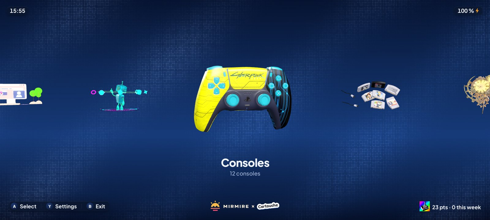 |  |

## Dual screen

On handhelds with two screens, like the AYN Thor and AYANEO Pocket DS, or with a clip-on screen like the Retroid Dual Screen add-on, Mirmire uses both. The menu stays on the main screen and the second screen shows one of these:

- **Game details** (the default): big cover art, the description, year, genre and players, when you last played, and your RetroAchievements progress for the game you've selected. Select a console and it shows that console with the games you played lately. With nothing selected, it shows the clock and your last game. Tap **Play** or **Details** there, or tap a cover to open that game on the main screen.
- **Home page widgets**: your widget board, used by touch.

While a second screen is in use, the Home tab (and Big Picture's Widgets card) leaves the main screen: pick **Home page widgets** above to have them on the second screen.

Your controller always works the menu, never the second screen, even right after you touch the second screen, so nothing gets lost between them.

**Text size.** A clip-on screen is drawn at the main screen's size automatically. **Second screen text and icon size** makes it bigger or smaller from there (70–160%).

**Retroid Dual Screen add-on.** Retroid's own **Turn off handheld console's screen** setting (Video Output) switches the handheld's screen off when the add-on is attached. While the add-on is used as a second screen, Mirmire turns that setting off so both screens stay on, and puts it back for a TV. This needs the [one-time setup](#performance-modes-and-stick-lights-one-time-setup).

**Swap screens** puts the menu on the second screen and the details or widgets on the main one, for example the menu on the AYN Thor's bottom touch screen and the art on the big top screen. Games still open on the main screen. Some devices keep the home app on the main screen; Mirmire tells you if swapping isn't possible.

**Move between screens with a controller.** At the edge of the menu, press toward the second screen to move onto it: its buttons, covers and widgets get a focus ring, the D-pad moves between them and **A** presses. Long widget boards scroll as you go, and Down walks down a column before it leaves the screen. Press back toward the menu at its edge, or **B**, to return. A touch works as usual; a tap on the second screen also sets where the D-pad starts there.

**Screen arrangement** tells Mirmire where the second screen is (below on the AYN Thor, AYANEO Pocket DS and Retroid Dual Screen add-on). Drag the second screen on the little map to its side of the main screen, or select the map, press **A** and use the D-pad. Moving between screens follows it, and **Swap screens** is taken into account.

**DS, 3DS and Wii U games** need the second screen for themselves, so Mirmire leaves it free while you play them and comes back when you return. Set your emulator's dual-screen layout in the emulator itself (WatermelonDS, melonDS, Azahar, Cemu and DraStic have it). Other games leave the details up while you play.

**A clip-on screen or a TV?** Built-in screens are recognized on their own. The first time an external screen is connected, Mirmire asks whether it's a second screen or a TV or monitor, and remembers the answer. A TV switches to Big Picture, if **Big Picture when docked** is on.

Find all of this in **Settings › Layout › Dual screen**, where **Ask again about connected screens** forgets your answers.

**Themes** can dress the second screen too: its own wallpaper, what goes behind a game's details (the game's art, the console's backdrop, or just the wallpaper), how dark it is, and whether the clock shows when nothing is selected. Theme Studio has a dual-screen preview for this.

| Both screens | A console | Widgets |
|---|---|---|
|  |  |  |

## Controls

| Button | Action |
|---|---|
| D-pad / stick | Move |
| A | Select |
| B | Back (closes the keyboard first) |
| X | Favorite |
| Y | Search (home), keep on device (game details) |
| L1 / R1 | Previous / next tab or settings section |
| L2 / R2 | Artwork type / view |
| Select | Sort |
| Start | Settings |

On a keyboard, arrows move, Enter selects, and Esc or Backspace goes back. On the Consoles screen, **B** returns to the first console, and up and down stay in the same column. In Settings, **right** opens the selected section's first option and **left** comes back to the list. Button labels follow **Settings › Controls**.

When a controller is connected, the buttons you can press are shown at the bottom right, low in the navigation bar's strip so they don't cover anything.

## Spotlight and play time

The **Spotlight** tab gathers:


- **Achievement of the week** from RetroAchievements, with a button to the game when it's in your library;
- **Close to mastery:** games nearest to 100% of their achievements;
- **Quick to play:** arcade, puzzle, fighting and other pick-up-and-play genres;
- **Play together:** multiplayer games;
- **Not tried yet:** a new pick every day;
- **Your play time:** this week, all time, your top console and most played games.


Mirmire times each play from launch until you come back. A game's page shows its play time and, once there's enough history, about how long the battery will last playing it in its performance mode.

**Each game's performance mode is learned** (Settings › Emulators › Performance modes › Learn each game's mode, on by default). After a couple of plays of five minutes or more, a game gets a mode that suits its console: battery saver for 8- and 16-bit systems, standard for consoles like the N64 and PlayStation, and performance for demanding ones like the PS2 and GameCube. If most of its recent plays ended hot (the battery at 41°C or more), it goes one step lower. The game's page says which mode was picked and why. A mode you choose on a game always wins. Modes need the [one-time setup](#performance-modes-and-stick-lights-one-time-setup).

## RetroAchievements

Sign in under **Settings › Trophies** with your username and **Web API key** (from your RetroAchievements account settings). Progress shows on game cards and pages, and Mirmire also signs RetroArch in for you.

## AI

**Settings › AI** sets up the AI that Pixel Pal (and other plugins you allow) use for game hints and chat. Choose where it runs:

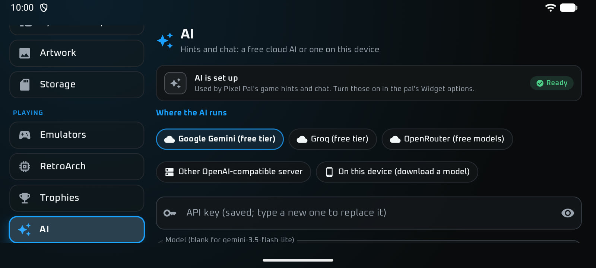

- **Google Gemini**, **Groq** or **OpenRouter**: free tiers with your own API key. Press the "Get a free key" button to open the provider's page, paste the key and press **Save**.
- **Other OpenAI-compatible server**: LM Studio or Ollama on your PC; enter its address.
- **On this device**: downloads a model once, then works offline and nothing leaves the device. Small (344 MB), Medium (977 MB), Better (2.6 GB, about 6 GB of memory) or Best (3.7 GB, for devices with 8 GB of memory). Bigger models know more about games but take longer to answer.

**While you play** (one screen): turn on **Pal over your games** and allow "Display over other apps" when Android asks. While a game runs, a small 💬 button sits in a corner: drag it wherever it's out of the way (it stays there), and tap it to chat with your pal without leaving the game. Its tips show beside the button for a few seconds without blocking touches. Press **B** or ✕ to close the chat; the pal goes away when you return to Mirmire, and its notification has a **Hide** button. To open the chat from a controller, turn on **Press both sticks to open the chat**: Android only lets apps see controller buttons in another app through Accessibility, so it sends you there to switch on "Mirmire: open Pixel Pal's chat in games". It watches only the two stick clicks, only while the pal is over a game, and can't read the screen or what you type.

**Mirmire is greyed out in Accessibility ("Restricted setting")?** On Android 13 and later, apps installed from an APK instead of an app store can't turn on Accessibility until you allow it. Under the shortcut, Mirmire shows the steps and an **Open Mirmire's app info** button: tap ⋮ in the top corner, choose **Allow restricted settings**, confirm with your PIN or fingerprint, then turn Mirmire on in Accessibility. On some phones the ⋮ menu only appears after you've tried to turn Mirmire on once. Only do this if you installed Mirmire from its [official releases](https://github.com/Mirmire-Launcher/mirmire/releases). Some emulators that take over the controller may not let the shortcut through; tapping 💬 always works. On a handheld with a second screen, keep the pal there instead.

| Welcome back on the Home page | Chat while you play |
|---|---|
|  |  |

Press **Test** to check it works. Only a game's title and console are sent for hints, plus what you type in a chat; never your files, accounts or keys. Your key stays on the device and isn't included in backups.

---


## Emulators and RetroArch

**Settings › Emulators** shows which app plays each console, sorted by name. **Automatic** picks the best installed option, or you can choose RetroArch with a specific core, or a standalone emulator. Emulators are separate apps. Tap one under **Not installed** to get it:

- **Install** (hakuX, Xendroid Plus, ARMSX2, ARMSX3 and DroidDeck, which aren't on Google Play): Mirmire downloads the right APK from the emulator's official GitHub releases and hands it to Android, which asks you to confirm. The first time, Android asks you to allow Mirmire to install apps; turn on **Allow from this source**, go back and tap **Install** again. ARMSX2 and ARMSX3 get the build that suits your Android version and processor.
- **Get** (everything else): opens the emulator's Google Play page, or its download site when it isn't on Play (for example WatermelonDS and DraStic).

**Close the emulator when you come back** (Settings › Emulators, off by default): when you return to Mirmire from a game, the emulator is closed, freeing its memory so the next game starts fresh. Quit the game in the emulator first: if you only switch away with Home or recent apps, anything the game hasn't saved is lost.

**Automatic picks** (when you leave a console on Automatic and the app is installed):

| Console | Preferred standalone | RetroArch default core |
|---|---|---|
| PS1 | DuckStation (then ePSXe) | SwanStation (PCSX ReARMed available for low-end) |
| N64 | Mupen64Plus FZ | Mupen64Plus-Next |
| DS | WatermelonDS (then melonDS, DraStic) | melonDS DS |
| Saturn | — | YabaSanshiro (Beetle Saturn for stronger devices) |
| PS2 | ARMSX2 (then AetherSX2) | — |
| Dreamcast | Redream, then Flycast | Flycast |

**Xbox and Xbox 360** play in **hakuX** (Xbox) and **Xendroid Plus** (Xbox 360), both from GitHub. hakuX starts a game only once a games folder is set up inside hakuX itself; until then it opens its own setup. On Snapdragon devices both run better with a custom GPU driver (see [GPU drivers](#gpu-drivers)).

**Steam** games play in **DroidDeck**, which Mirmire can install for you: Mirmire opens each game in it by its Steam app id. Sign in to Steam inside DroidDeck first. Steam stays in the Emulators list even before you have Steam games, so you can install DroidDeck first.

**PlayStation 2 and 3** play in **ARMSX2** (PS2) and **ARMSX3** or **aPS3e** (PS3). Mirmire installs ARMSX2 and ARMSX3 from GitHub; aPS3e is on Google Play. Each needs its own one-time setup first: a PS2 BIOS for ARMSX2, the PS3 firmware for ARMSX3 and aPS3e. Mirmire then starts disc images directly. These emulators run on 64-bit Android only, and they don't start on an Android emulator (AVD).


**RetroArch setup** (Settings › RetroArch):

1. Install RetroArch.
2. Allow file access, so Mirmire can write RetroArch's config and prepare cores.
3. Press **Set up** to download the cores your library needs.
4. Once in RetroArch, choose **Load Core › Install or Restore a Core**: the list shows the cores Mirmire downloaded. Pick each one.

If you press Play before a core is installed, RetroArch can't start the game. Mirmire notices: a notification names the core to install, and the next Play shows the same steps instead of opening RetroArch.

**RetroArch settings.** Mirmire writes these before each launch, combined from three levels: the game's own settings first, then its console's, then all games'.

- **This device:** shows your device and chip, and suggests settings for it. Nothing changes until you press Apply.
- **All games:** aspect ratio, scaling, smoothing, screen effect (LCD grid or CRT scanlines), upscaling, bezel, run-ahead, fast-forward speed, resume where you left off, rewind, hotkeys, menu combo, input polling, touch controls, graphics driver, threaded video, menu style, pop-ups and FPS.
- **Per console:** Mirmire recommends some settings, such as integer scaling and an LCD grid for handhelds, run-ahead for older 2D consoles, FSR upscaling for 3D consoles on a sharp screen, and the N64 and Saturn fixes. You can keep each recommendation, follow all games, or choose your own.
- **Per game:** the settings button on a game's details page.

**Upscaling.** **Upscaling** sharpens a low-resolution game on a high-resolution screen. It replaces the screen effect while it's on, and its shader downloads once.

| Choice | Best for |
|---|---|
| **FSR** | 3D games (PlayStation, N64, PSP, Saturn, DS, Dreamcast). AMD's upscale-and-sharpen filter; light on the GPU. |
| **ScaleFX**, **xBRZ** | 2D pixel art: smooth, rounded edges instead of blocky pixels. |
| **AI · CuNNy** | Anything. A small neural network that upscales 2×. Vulkan only: with the OpenGL driver it uses FSR. |

Mirmire reads your screen's resolution. When it shows a 3D console at 2× or more, on a chip above entry level, FSR is recommended and already on for that console: the Upscaling row lists which ones. A choice for all games replaces those recommendations.

**Bezels.** **Bezel** puts console art around the picture, from The Bezel Project: **The console's**, or **The game's own** (falling back to the console's when a game has none). They download once, for most 8-bit to Dreamcast-era consoles. Bezels use RetroArch's overlay, so they show only while a controller is connected, in place of the touch controls.

### Bring over from RetroArch

If you played through RetroArch from another app (ES-DE, Daijishō…), **Bring over from RetroArch** at the top of Settings › RetroArch (and in setup) copies your saves and save states for games in your library, your RetroArch settings (controls, hotkeys, video, audio and menu) and BIOS files into Mirmire's setup. Only new or newer files are copied, and RetroArch's own folders aren't changed. RetroArch keeps its settings in a private folder on some devices; finish the [one-time setup](#performance-modes-and-stick-lights-one-time-setup) and they can come too.

**Default hotkeys** (hold **Select**, then press):

| Button | Action |
|---|---|
| X | RetroArch menu |
| Start | Quit to Mirmire |
| R1 / L1 | Save / load state |
| R2 | Fast-forward |
| L2 | Rewind (when on) |

Holding **Start** also opens RetroArch's menu.

## BIOS files

**Settings › RetroArch › Check BIOS files** checks every BIOS file the consoles in your library need, for each emulator and RetroArch core. Each file is checked by its MD5 checksum against libretro's list, and marked **Required**, **Recommended** or **Optional**. It shows whether the file is there and good, missing, the wrong version, or sitting in the wrong folder, and names the exact folder it belongs in. Standalone emulators are checked too, such as DuckStation, AetherSX2, Dolphin and Redream. Some emulators keep their files in a private folder that Android doesn't let other apps read; those are marked **Can't check**. Turn on **Show every console** to see consoles you don't have games for yet.

When a console is missing a file its games need, the row at the top says **Games won't start**, and those games' pages show a note that opens the BIOS page.


- **BIOS folder:** pick a folder on your storage, like the saves and artwork folders. Files sync both ways: good files there are copied to the device, and good files on the device are uploaded. Left on automatic, Mirmire looks for a `bios`, `system` or `firmware` folder in your libraries.
- **Sync BIOS files from storage** brings new files over on every library sync. Files are recognised by checksum, so `SCPH-5501.BIN` is saved as `scph5501.bin`, where RetroArch expects it.

## GPU drivers

On Snapdragon phones and handhelds, newer GPU drivers often make demanding emulators faster and fix glitches. **Settings › Emulators › GPU drivers** shows your GPU (for example **Adreno 650**), which installed emulators can load a custom driver (hakuX, Xendroid Plus, ARMSX2, ARMSX3, aPS3e, DroidDeck, Eden, Citron, Sudachi, Dolphin and Vita3K), and **Find drivers for Adreno 6xx** (or 7xx, 8xx, matching your device), which checks the latest releases from [StevenMXZ](https://github.com/StevenMXZ/Adreno-Tools-Drivers) and [K11MCH1](https://github.com/K11MCH1/AdrenoToolsDrivers) and marks one **Suggested**. Tap one to download it. Custom drivers only exist for Adreno 6xx to 8xx, so on other GPUs (Mali, Xclipse, PowerVR or older Adreno) the section explains that emulators use the device's own driver.

To use it, keep the `.zip` as it is, open the emulator's GPU driver settings (hakuX: **Settings › GPU driver › Add a driver**; Xendroid Plus: **Custom GPU Drivers › Import ZIP**; ARMSX2 and ARMSX3: **Settings › Renderer**, choose **Vulkan**, then **Import .zip**; aPS3e: its custom driver option; Eden, Citron and Sudachi: **GPU driver manager › Install**), pick the file, make it the active driver and restart the game. If a game looks wrong, switch back to the system driver. Drivers only load inside the emulator; nothing on your device is changed.

## Performance modes and stick lights: one-time setup

Android only lets an app change performance modes, stick lights and a few device settings with **Wireless debugging** access. Mirmire sets this up once, on the device itself, with no computer or other app:

1. **Turn on Developer options:** in About, tap Build number 7 times.
2. **Connect to Wi-Fi.** Wireless debugging needs a Wi-Fi network, not the internet.
3. **Pair Mirmire:** press **Start pairing**, turn Wireless debugging on, tick **Always allow on this network**, tap **Pair device with pairing code**, then type the code into Mirmire's notification.

You'll find the steps in **Settings › Emulators › Performance modes**, **Settings › Device** and during setup. After pairing, Mirmire reconnects by itself whenever you're on Wi-Fi, restarts included. Already use **Shizuku**? Start it and Mirmire uses it instead. Android 10 and older need Shizuku.

---


## Library cleanup

Big libraries often have several versions of each game. **Settings › Library › Cleanup:**

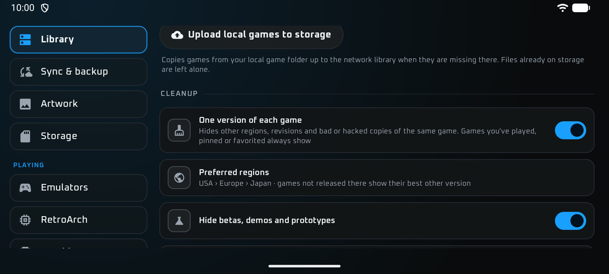

- **One version of each game** shows one copy per game, picked by your **Preferred regions** in order (a World release counts as your first choice), then the latest revision, preferring clean dumps over bad, hacked or translated ones. A game only released elsewhere shows its best version. Games you've played, pinned or favorited always show.
- **Hide betas, demos and prototypes.**
- **Check games against No-Intro:** games are checked against the No-Intro list (from libretro-database) when they're downloaded or already on the device. **Check all** reads the rest from your storage. Disc-based consoles aren't covered. A game's page shows **Verified dump**, **Bad or modified dump** or **Not in No-Intro list**.

The filter button above the games list switches between **Cleaned up**, **Everything** (hidden versions too) and **Didn't pass check**.

|  | 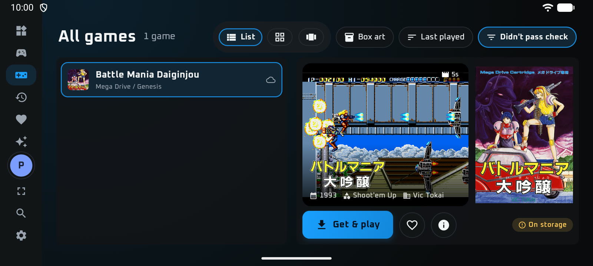 |
|---|---|

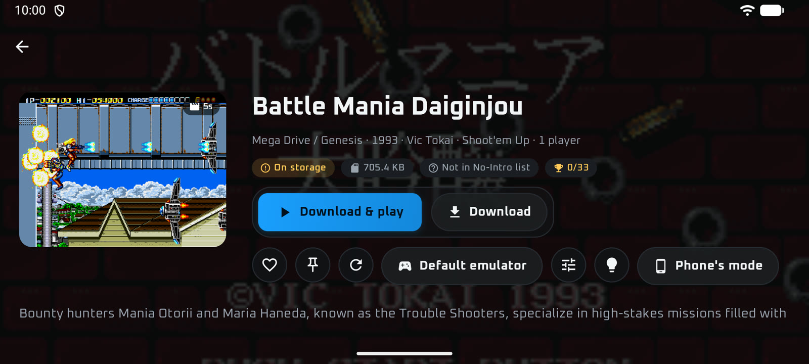

## Artwork

**Settings › Artwork** picks the source:

| Source | Notes |
|---|---|
| Auto | The best available for each game |
| Libretro | Box art, screenshots and title screens. No account needed |
| ScreenScraper | Adds 3D boxes, cartridges, fan art, videos and descriptions. A free account raises the daily limit |
| RetroAchievements | Uses RetroAchievements images |

Artwork already on your storage, in an ES-DE `downloaded_media` or `media` folder, is used first and kept on the device once loaded. Next, Mirmire uses artwork other frontends downloaded on this device: ES-DE's `downloaded_media` and gamelists, RetroArch's thumbnails and LaunchBox's images (when LaunchBox's folder is on normal storage, not inside the app). Nothing is copied or changed. Daijishō keeps its artwork inside the app, where Mirmire can't read it. Online lookups only run when you press **Find missing artwork online**.

## Storage

**Settings › Storage:**

- download only on Wi-Fi or Ethernet;
- download small games automatically;
- free up space automatically by removing large games you haven't played for a while (saves and pinned games are kept);
- free up space now.

To push games from the local game folder **up** to a network library when they're missing there, use **Settings › Library › Upload local games to storage** (same Wi‑Fi / Ethernet rule as downloads).

## Pack for a trip

**Settings › Storage › Pack for a trip** gets games ready to play offline. Pick favorites, recently played, games already on the device or whole consoles. Mirmire downloads them, keeps them from being removed to free space, and syncs their saves, states and BIOS files. While you're away, games start without waiting for your storage. When a network is back, saves, settings and "last played" sync straight away. **Back home: unpack** lets free-up-space remove them again.


---


## Save sync

**Settings › Sync & backup › Save files on your storage.** With sync on, your in-game saves upload to `Saves/<console>/` on your storage when you come back to Mirmire, and save states to `Saves/<console>/states/`. For games from a [RomM](#romm) library, they're stored as that game's saves and states in RomM. Before you play, newer saves and states on the storage are downloaded. Earlier versions of saves are kept, so you can go back to one.

**Sync favorites with your storage** (same page) keeps each player's favorites and **Keep on device** pins in `Mirmire/collections.json` on your storage, so every device shows the same favorites. If you change favorites on two devices while one is offline, both changes are kept: each game's favorite and pin keep whichever change was made last, and removing a favorite on one device removes it on the others too.

**Played on two devices before syncing?** If a game's save or save state changed on this device *and* on your storage (or a paired device) since they last matched, Mirmire never overwrites either one. The next time you open or play that game it asks **Which save should Mirmire keep?**, showing each side's device, when it was saved and how long it was played:

- **Keep this device's save** or **Keep *the other device's* save**: the one you pick is used everywhere.
- **Keep both**: plays the newer one and keeps the other as a copy: a version (`vN`) in the game's saves folder on your storage, or, for a paired device, in RetroArch's `.conflict-copies` folder.
- **Decide later** (or **B**) leaves both copies untouched and asks again next time.

Uploads in the background, such as when the screen turns off, never ask: they keep the question for the next time you open the game.

### Syncthing

If you already use [Syncthing](https://syncthing.net) (Syncthing-Fork, BasicSync or the original app), your saves can sync through it, straight between your devices with no NAS. Open **Settings › Sync & backup › Syncthing**, turn on **Sync saves through Syncthing** and choose the **Syncthing folder** your saves should go to. Paste Syncthing's API key, found in its settings, to pick from its shared folders and see whether the folder is up to date. Without a key, you can pick the folder yourself.

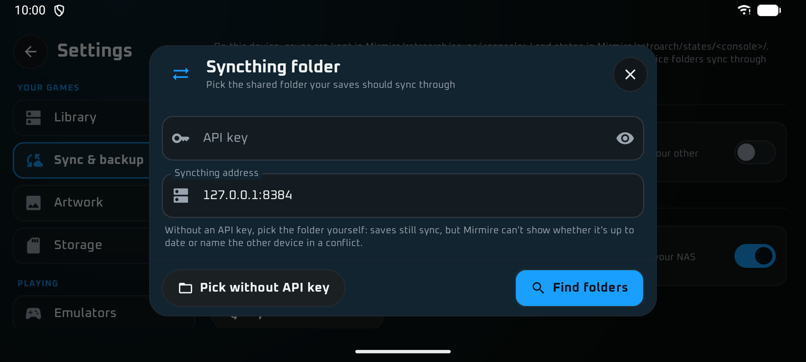

Saves and states use the same layout and earlier versions as other save storage. Mirmire waits while Syncthing is still bringing this game's files over, and asks it to rescan after a save. When Syncthing finds the same save changed on two devices, its conflict copy turns into the usual **Which save should Mirmire keep?** question, naming the other device. Syncthing's leftover conflict files are then tidied up.

## Continue on another device

When another of your devices played a game more recently, the home screen offers **Continue**: the game opens here with that device's save and save state, so with **Resume where you left off** on you're right where you stopped.


- **Devices that use the same library storage** need no setup: they share saves, states and "last played" through it.
- **Devices without shared storage** (for example, games in a folder on each device) pair once over Wi-Fi in **Settings › Sync & backup › Continue on another device**: press **Pair** next to the other device, check that both screens show the same 6-digit code, and accept on the other device. Paired devices swap newer saves and states, encrypted, whenever Mirmire is open on both on the same Wi-Fi. A replaced copy is kept in `Mirmire/retroarch/.peer-backup/`.


**Upload when the screen turns off** (on by default): press power in the middle of a game and its saves and save states upload a few seconds later, and your other devices are told what you were playing so they offer **Continue**. RetroArch writes in-game saves when it pauses. To pick up at the exact moment, save a state first with the hotkey + R1.

**Play together:** with a paired device on the same Wi-Fi, a downloaded game's page shows **Play together**. The other device gets an invite. When it's accepted, the game starts on your device and RetroArch begins hosting by itself. The other device opens the same game with your address filled in; there, open RetroArch's menu (hotkey + X) and choose **Netplay › Connect to Netplay Host**. RetroArch doesn't let other apps make it join a game, so that last step stays manual. Both devices need the same game from the same library.

## Backups

**Settings › Sync & backup › Backups** saves Mirmire's setup to your storage: settings, libraries (without passwords), emulator choices, RetroArch settings, favorites, stick-light colors, imported themes, icon packs and widget plugins, and your Home page widgets (widgets from other apps are left out). Pick the **Backups folder** like the saves folder (automatic: `Mirmire/backups` in your first network library).


- **Back up automatically:** once a day; the newest 10 backups of each device are kept.
- **Restore a backup:** from this device or any other. Libraries it adds ask for their password.
- **Include RetroArch's own settings** (on by default): also backs up `retroarch.cfg` and the core options, overrides and remaps in RetroArch's config folder. Anything tied to one device is left out: folder paths, video and audio drivers, controller button numbers and screen size. RetroArch's sign-in isn't included either. Restoring merges these into the device's own RetroArch setup. Settings sync doesn't change RetroArch's files; they only come back when you restore a backup.
- **Keep settings in sync:** changes back up a minute later, and Mirmire applies newer settings from your other devices when it opens. Each setting is merged on its own, so a change on one device doesn't undo a different change made on another. Screen orientation, menu style and sizes stay per device.

Passwords and keys are never backed up.

---


## Themes and layout

- **Look:** theme (including **Green**, **Blue**, **Neon**, **Pearl** and **Sky Console**, styled after handheld and console menus), accent color, corners, animations, console icons, background (theme wallpaper, gradient, solid color, your own photo or video), and navigation sounds and music. **Get Iconic** and **Get Console Icon Pack** download extra art. You can also import theme or icon-pack ZIPs.
- **Layout:** **Text and icon size** (80–150%, like Android's display size: menus, dialogs and widgets all follow it), screen orientation, **Keep the screen on** (off, while charging, or always, while Mirmire is open), top bar or side menu (the side menu scrolls when it has more buttons than fit), consoles view, console tiles or icons only (with icon size), games view, card size, artwork type, what's shown on cards, and video previews.

Making your own theme, icon pack or widget plugin: try **[Theme Studio](https://mirmire-launcher.github.io/mirmire/theme-maker/)** in your browser, and see [Make your own themes and icon packs](CREATING.md) and [Make widget plugins](PLUGINS.md). The file format is in [THEMES.md](THEMES.md).

## Profiles

**Settings › Profiles** (or **Who's playing?** during setup) adds a player for each person. Each has their own favorites, recently played, play time, saves and save states. Switch with the player button next to Search.

| 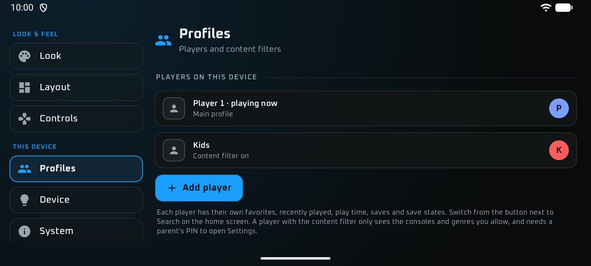 |  |
|---|---|

- **Name, color and avatar:** choose from bold colors (navy, vibrant red…) or softer ones, and an avatar made with [DiceBear](https://www.dicebear.com) in one of 12 styles (Adventurer, Avataaars, Personas, Miniavs, Open Peeps, Toon Head, Big Ears, Lorelei, Critters, Clay, Voxel Art and Voxel Bot), with **Shuffle** for more faces. Each style's artist and license are shown under the faces and in **Settings › System**. Each face is made from a random code, so nothing about the player is sent; it needs the internet the first time it's shown. Without one, the player's initial shows on their color.
- **PIN:** asked when switching to that player.
- **Content filter** (for a child's profile): only the consoles you allow, without the genres you hide. A filtered player can't see hidden games and needs a parent's PIN to open Settings, so set a PIN on your own profile.

RetroAchievements uses one account for every player.

## Parental controls

**Settings › Parental controls** turns a player into a **Child profile** with age ratings, allowed games and play time limits, all kept behind a **Parent PIN**.

|  | 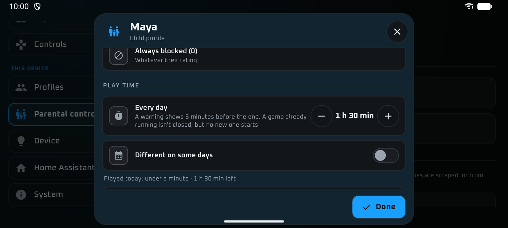 |
|---|---|

- **Set a parent PIN** first. It's asked to change these settings, open Settings, or leave a child's profile, and it's entered with the D-pad or touch.
- **Highest age rating:** a child sees only games rated up to that age. Ratings come from ScreenScraper (ESRB, PEGI and CERO), from RomM's game details, and from LaunchBox if you choose **Read ratings from LaunchBox**. Where boards disagree, the strictest wins.
- **Games without a rating** can be allowed, or blocked until you allow them one by one.
- **Allowed** and blocked games override the rating, and **Set a game's age rating** fixes a rating that's missing or wrong.
- **Play time:** no limit, the same limit every day, or different limits on some days. Mirmire warns before time runs out, and a game that's already running is never closed.

A game the child can't play is hidden. If they reach it anyway, Mirmire explains why and a parent can allow it, or add time **Just for today**, with the PIN.

## Home Assistant

**Settings › Home Assistant** lets your home react to what you play: dim the lights when a game starts on the TV, or run a scene when you stop.

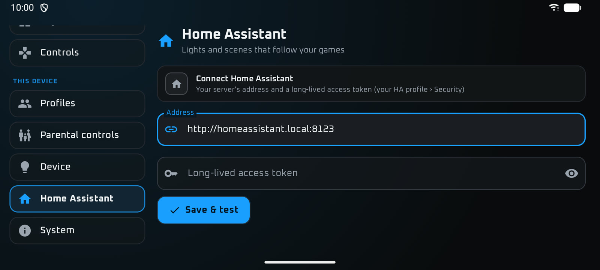

1. Enter your Home Assistant **Address** and a **Long-lived access token** (in Home Assistant, open your profile › **Security**), then press **Save & test**.
2. Add actions for **game started**, **game stopped**, **TV dock on or off**, **idle**, or **back from idle**. Each one can **Fire event** (`mirmire_game_started` and so on) or **Call service**, like `light.turn_on` or `script.movie_mode`. Use **Pick from Home Assistant** to choose one.
3. Optional JSON data can use `{game}`, `{console}`, `{device}` and `{playtime_minutes}`. **Only when on TV dock** skips the action on the handheld screen.

**Test now** runs an action straight away, and each action shows how its last run went. The token is stored encrypted and never backed up.

## Stick lights

On Retroid and AYN handhelds with lights around the analog sticks (Retroid Pocket 5, 6 and Mini, AYN Odin 2, Odin 2 Portal, Odin 3 and Thor), Mirmire can set their color. Open **Settings › Device**. This section only appears on those devices, and its light options only once Mirmire has found the lights.


**It needs the [one-time setup](#performance-modes-and-stick-lights-one-time-setup)**, the same as performance modes (or Shizuku). Mirmire then checks which light settings your device has.

**In Mirmire**, the lights can:

- **Device setting:** stay as set in your device's own settings;
- **Theme color:** follow the theme. Some themes have their own light colors (Cyberpunk, Comic, Insert Coin, and the Console themes: green for Green Console, the Retroid's own blue for Blue Console, red and blue for Neon Console); otherwise the lights use your accent color;
- **Battery level:** go from green when full, through yellow, to red when low;
- **Off:** stay off while Mirmire is open.

**While playing**, a game can start with:

- **Same as Mirmire:** the light doesn't change;
- **Console color:** for example red for NES, blue for Genesis, blue and green for N64;
- **Game's cover art:** the main colors of the game's box art, one per stick;
- **Performance mode:** green for battery saver, the theme's color for standard, red-orange for performance;
- **Off:** the lights turn off when the game starts.

| Console colors | A console's color |
|---|---|
| 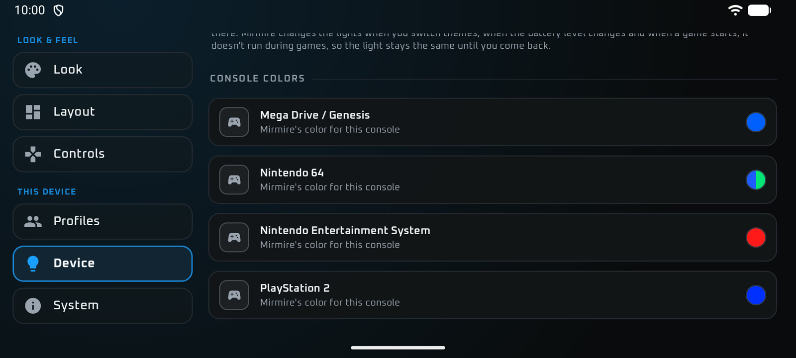 |  |

With **Console color** or **Game's cover art**, you can change any console's color in the list below. To give one game its own color, press the light button on its details page.


**Brightness** sets how bright the lights are. Mirmire saves your device's own light settings before its first change. **Put back my device's lights**, or setting both options back to the device's own, restores them.

Good to know:

- Lighting effects in your device's settings, such as breathing or rainbow, replace Mirmire's colors. Set the effect to solid there.
- Mirmire sets the color when you switch themes, when the battery level changes and when a game starts. It doesn't run during a game, so the light stays the same until you come back.
- Lights that react to sound aren't supported: they'd need Mirmire running and recording audio during games.

## Home screen widget

This is Mirmire's widget for your phone's own home screen (for widgets inside Mirmire, see [Home page and widgets](#home-page-and-widgets)). On a phone with its own launcher, add the **Mirmire: Continue** widget from your launcher's widget list, or from **Settings › System › Add widget to home screen**. It shows your last game with its play time and the four before it; tap one to open it.

---


## Updates

**Settings › System › App updates** shows your version and checks this repository for a newer one. When there is one, press **Download**, then **Install**. The first time, Android asks you to allow Mirmire to install apps. Turn on **Check automatically** to check once a day; nothing downloads until you choose to.

## Android settings

**Settings › System › Android settings** opens the device's own settings, handy when Mirmire is your home screen: **Wi-Fi**, **Bluetooth**, **Display**, **Sound**, **Battery** and **Apps**.

## Troubleshooting

**A game says the emulator isn't installed.** Install it from Settings › Emulators (**Install** or **Get** beside it), or choose another emulator for that console.

**Install does nothing, or opens Android's Install unknown apps screen.** Mirmire needs permission to install apps once: turn on **Allow from this source** for Mirmire, go back and tap **Install** again.

**RetroArch says the core is missing, or a game stays on a black screen.** The console's core probably isn't installed in RetroArch. Open RetroArch, choose **Load Core › Install or Restore a Core**, and pick the core Mirmire named. Mirmire also tells you this with a notification after a launch that didn't start.

**A game shows a black screen in RetroArch with its core installed.** Switch **Graphics driver** to OpenGL in Settings › RetroArch, or turn off the screen effect or upscaling for that console.

**N64 controls don't respond.** Keep the recommended **Input polling: Early** for N64.

**Saturn crashes when quitting.** Keep **Resume where you left off** off for Saturn, as recommended.

**My library doesn't find the server.** Enter the address yourself, check the share or folder name, and make sure the device is on the same network.

**An update won't install ("signed with a different key").** That copy of Mirmire came from somewhere else. Uninstall it, then install the release APK. Your library will need to be added again.

**The stick lights don't change.** Check that the one-time setup is done (or Shizuku is running and allowed) in Settings › Device, and that the lighting effect in your device's settings is set to solid. If Mirmire says no light settings were found, turn the stick lights on once in your device's settings, then press **Check again**.

**The Retroid's own screen goes dark with the Dual Screen add-on.** Finish the [one-time setup](#performance-modes-and-stick-lights-one-time-setup) so Mirmire can keep it on, or turn off **Turn off handheld console's screen** in Retroid's Video Output settings.

**An Xbox game opens hakuX's setup instead.** Set up a games folder inside hakuX once; after that, Mirmire's games start directly.

**A game doesn't start: "BIOS".** Check **Settings › RetroArch › BIOS files** for that console.

**A game is missing from the list.** Library cleanup may show another version instead: switch the filter above the games list to **Everything**.

**Start over.** Settings › System › Reset settings resets each area on its own. Your libraries, downloaded games, saves and artwork are kept.

---

<sub><b>Legal.</b> Mirmire is a launcher only. It doesn't include or provide any games, ROMs or BIOS files: use it with games you own and have the right to play. Games appear in the screenshots for illustration only. DOOM is a registered trademark of id Software LLC, a ZeniMax Media company. Nintendo, Super Nintendo, Game Boy, Nintendo 64, SEGA, Mega Drive, Genesis, PlayStation, Xbox, Steam, RetroArch, and all other game titles, console names and trademarks belong to their respective owners. Game artwork comes from ScreenScraper and the Libretro thumbnail project and belongs to its respective owners. Mirmire is an independent project and isn't affiliated with or endorsed by any of these companies.</sub>
